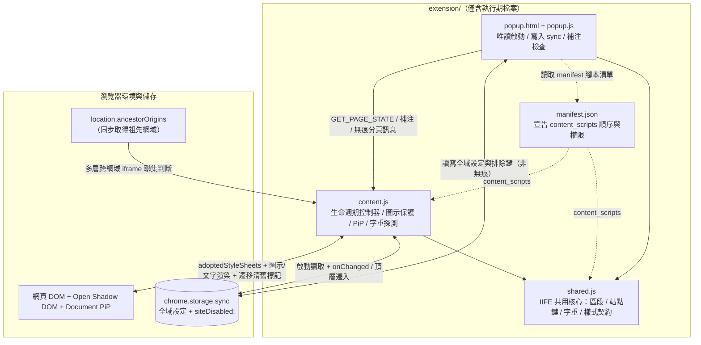
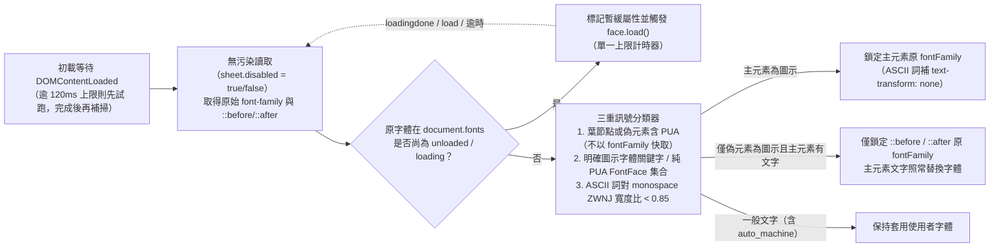

# Website Font Changer 333 v2.0.0 設計規格

*   **Author:** tbdavid2019
*   **Status:** Proposed
*   **Date:** 2026-11-20

--------------------------------------------------------------------------------

## Overview

Website Font Changer 333 是一個已上架 Chrome Web Store（以下簡稱 CWS）、提供給 Chrome 與 Brave 瀏覽器使用者的 Manifest V3（MV3）擴充套件（目前版本 `v1.8.8`），讓使用者將網頁文字替換為本機系統字體，並支援「單一字體」與「CJK（中日韓）／非 CJK（英數與標點）分開指定」兩種模式。

本次 `v2.0.0` 設計在**不新增任何瀏覽器權限**、**不引入建置／打包工具鏈**、且**維持精簡彈窗介面**的前提下，一併處理現有架構的五個結構性問題：圖示保護誤傷非 Google 圖示與一般底線文字、停用狀態背景消耗與跨裝置同步字體覆寫缺陷、分流模式的跨系統字重與日韓字元缺漏、「此網站不生效」缺乏跨裝置同步與跨網域內嵌框（iframe）連動的能力，以及正式發行檔案與測試腳本混雜於倉庫根目錄的打包風險。

--------------------------------------------------------------------------------

## The Problem

目前 `v1.8.8` 的實作存在以下五類根因問題：

1. **圖示保護採猜測與強制覆寫，同時破壞特殊圖示與一般底線文字**
   * 擴充套件在網頁開始載入時（`document_start`）即注入高優先權規則 `body * { font-family: ... !important }`，隨後靠 `EXCLUDE_CLASSES`（67 項靜態 CSS 選擇器）、英文單字清單、同源樣式表掃描（遇到跨網域 CDN 樣式表會因同源政策阻擋而跳過），以及針對私用區 Unicode 碼位（Private Use Area，簡稱 PUA）與小寫底線單字（如 `auto_machine`、`u_uuuu_uuuu`）的文字比對來貼上排除標記。
   * 凡被該文字比對命中的元素，樣式表會強制改寫為 `'Google Symbols' / 'Material Icons' !important`。這造成三類故障：(a) 程式碼區塊外的一般網頁文字若含底線（`auto_machine`、`u_uuuu_uuuu`），會被覆寫為圖示字體而顯示錯亂；(b) 微軟 Outlook 等使用 Fluent / Fabric PUA 字體的網站，原本圖示字體被 Google 圖示字體蓋掉而顯示為破圖方塊（`□`）或空白；(c) Google Fonts、Google Meet、Outlook 等使用混淆字體／類別名稱、跨網域樣式表，或將 PUA 圖示置於 CSS 偽元素（`::before` / `::after`）的元素，會因漏判而被文字字體覆蓋，顯示為原始英文佔位字詞（連字圖示）或破圖方塊（PUA 缺字）。此外，過寬的子字串選擇器（如 `[class*="ti-" i]`、`[class*="ri-" i]`、`[class*="la-" i]`、`[class*="bi-" i]`）也會誤排除含有 `multi-`、`label-`、`bilingual-` 的正常排版元素，並拉高大型單頁應用（SPA）的樣式計算成本。

2. **開啟彈窗會覆蓋跨裝置同步字體，且執行期存在持續觀察與記憶體洩漏**
   * **開彈窗覆寫同步字體**：開啟彈窗初始化時會無條件寫回 `chrome.storage.sync` 並通知當前分頁。若使用者在 macOS 選用該系統專屬字體（例如 `PingFang TC`），隨後於 Windows 電腦打開彈窗查看，選單因找不到該字體會重設為空值並寫回雲端，清空跨裝置同步設定；切換介面語言（`uiLanguage`）等無關設定亦會觸發所有開啟分頁重跑完整 DOM 掃描。
   * **停用期背景消耗**：主文件的 DOM 變動監聽器（`MutationObserver`）在全域關閉或網站排除時並未斷開，仍在全網所有分頁與內嵌框持續掃描並寫入 `data-font-changer-*` 屬性。
   * **記憶體洩漏與重複注入契約錯誤**：動態監聽的 Shadow DOM 根節點以強參照保存且未隨元件卸載清理，Document Picture-in-Picture（PiP）文件物件亦混入 Shadow DOM 追蹤集合；動態補注入內容腳本時未移除先前的擴充套件監聽器、ShadowRoot 觀察器與計時器，且 `onMessage` 同時呼叫 `sendResponse` 與回傳 `Promise.resolve` 違反 MV3 訊息契約。

3. **分流模式（CJK / 英數分開）跨系統字重退避與日韓區段缺漏**
   * 分流模式將所有字重候選與個人字體特例後綴（`' 半糖'`）塞進單一 `font-weight: auto; font-style: normal` 的 `@font-face`（`asciiPart` 截斷亦會誤傷如 `"思源黑體 TW"` 等名稱），使支援獨立粗體／斜體檔案的系統無法載入真實粗斜體，並鎖定可變字體（Variable Font）的斜體軸。
   * `CJK_UNICODE_RANGE` 遺漏日文平假名、片假名與韓文諺文，使日韓文字落入非 CJK 字體；當分流模式兩欄皆維持系統預設時，還會錯誤套用「單一字體」模式保存的字體。

4. **「此網站不生效」綁定單站本機儲存，無法跨裝置同步也不涵蓋跨網域內嵌框**
   * 排除狀態寫在目標網站各自的 `localStorage` 中，導致無法透過 Chrome 帳號同步、清除網站資料即遺失、在跨網域內嵌框（iframe）內無法讀取頂層頁面停用狀態；同時彈窗因保留網頁版模擬邏輯而將 `localhost` 頁面誤標示為「網頁版預覽」。

5. **專案結構混雜與測試依賴本機環境**
   * 擴充套件執行檔與測試檔（包含啟動 Headless Chrome 與除錯埠的測試程式）、說明圖片及未使用的網頁入口 `index.html` 皆混放於倉庫根目錄，直接壓縮資料夾上傳商店易夾帶非執行檔。同時 `content.js` 與 `popup.js` 重複維護字元區段與 `@font-face` 組裝邏輯，`popup.js` 缺乏單元測試，真實 Chrome 渲染測試亦跳過非 macOS 系統且綁定本機個人字體路徑。

--------------------------------------------------------------------------------

## Goals

*   **G1 — 圖示準確保留與消除底線誤判**：在可被偵測的頁面與 Open Shadow DOM 上，Google 系列（Fonts / Meet / Play / Workspace）、微軟 Outlook 及其他使用 PUA、偽元素或連字的圖示保持網站原本各自的圖示字體；同時一般底線文字（`auto_machine`、`u_uuuu_uuuu` 等）於單一字體與分流模式皆套用使用者選定字體。接受開頁初載階段存在極短暫的未替換字體閃爍（`DOMContentLoaded` / `120ms` 保護上限內），後續動態操作不產生重繪閃爍。
*   **G2 — 停用期零背景 DOM 觀察與無資料覆蓋之執行期穩定性**：擴充套件全域關閉或當前框架符合停用規則時，中斷所有 `MutationObserver` 與字體監聽且移除注入樣式與屬性；Shadow DOM 追蹤不保留強參照以利垃圾回收，重複注入先卸載舊實例；開啟彈窗保持唯讀，不寫入儲存區亦不覆寫未於本機安裝的跨裝置同步字體。
*   **G3 — 保留並整理 Google Meet Document PiP 支援**：Google Meet 子母畫面持續支援字體替換與圖示保護，與主文件共用變動觀察邏輯並獨立管理生命週期，修復選取器未跳脫與跨文件字體註冊錯誤。
*   **G4 — 站點停用雲端同步與同設定檔安全遷移**：在不新增任何權限下將「此網站不生效」遷移至 `chrome.storage.sync`（每個排除網域獨立一鍵），自動承接並移除同瀏覽器設定檔中頂層網站的舊 `localStorage` 紀錄；無痕視窗絕不寫入持久儲存區；跨網域內嵌框採用所有祖先與自身網域的聯集停用規則；彈窗內「重設」按鈕保留已排除網站與介面語言設定。
*   **G5 — 分流模式雙邊隔離與跨系統字重支援**：維持中、英數各自透過 `unicode-range` 區隔，補齊日韓文區段，移除個人字體硬編碼，改採不觸發授權詢問的本機 `FontFace.load()` 探測跨系統粗體／斜體實體面（並維持可變字體與單一字重字體在支援環境下的合成粗斜體能力）。
*   **G6 — 隔離目錄與跨平台自動化回歸門檻**：移除 `index.html` 與未使用的網頁版程式；建立 `extension/`（僅含執行期檔案，可直接壓縮上傳商店）與 `tests/` 目錄；以零建置方式抽出共用模組 `shared.js`；補齊單元測試與跨平台雙本機埠真實 Chrome 渲染測試（0 個跳過的測試），並通過 Chrome／Brave 實站手動檢查清單後釋出 `v2.0.0`。

--------------------------------------------------------------------------------

## Non-Goals

*   **NG1 — 不新增擴充套件權限**：維持 `activeTab`、`storage`、`fontSettings`、`scripting`，不新增 `host_permissions`、`tabs`、`webNavigation`，避免現有 CWS 使用者需重新授權；移除對 `window.queryLocalFonts()` 的呼叫。
*   **NG2 — 不排除程式碼或等寬區塊**：不將 `<code>`、`<pre>`、`kbd`、`samp` 或線上編輯器列入自動排除清單，確保依賴 `<pre>` 排版的網站（如 Disp BBS）維持套用選定字體。
*   **NG3 — 不保留獨立網頁版**：刪除 `index.html` 及其附屬網頁環境模擬程式碼與專屬寬螢幕卡片樣式。
*   **NG4 — 不擴充彈窗排除管理介面**：不在彈窗中新增「已排除網站管理清單」或獨立 Options 頁面，維持精簡操作介面。
*   **NG5 — 不引入建置或第三方執行期相依套件**：不新增 bundler、transpiler 或 `node_modules` 執行期依賴。

--------------------------------------------------------------------------------

## Critical User Journeys (CUJs)

### CUJ 1：在富含動態圖示與一般底線詞的網站啟用自訂字體
*   **Given**：使用者已啟用字體替換（單一字體或分流模式），並開啟 Google Fonts、Google Meet、Google Play、Outlook Web、GitHub 或 Disp BBS。
*   **When**：頁面完成初載，隨後使用者點擊選單、捲動列表或開啟對話框，動態載入新的 PUA 圖示（含 `::before`/`::after` 偽元素）、連字圖示，同時頁面上存在 `auto_machine`、`u_uuuu_uuuu` 等一般底線詞、正常排版類名（如 `multi-column`）及 `<pre>` 文章內容。
*   **Then**：除了開頁初載允許 `DOMContentLoaded`（`120ms` 保護上限內）的短暫初始閃爍外，各網站原圖示維持原本各自的圖示字體（混合文字與偽元素圖示的按鈕僅鎖定偽元素而不破壞按鈕文字字體），一般底線詞與 `<pre>` 內文皆套用使用者選定的文字字體，動態操作不產生重繪閃爍。

### CUJ 2：跨作業系統檢視彈窗與單項設定變更
*   **Given**：使用者在 macOS 設定了該系統專屬字體（例如 `PingFang TC`）並已同步；隨後於未安裝該字體的 Windows 電腦開啟擴充套件彈窗。
*   **When**：(a) 使用者僅開啟彈窗檢視狀態；(b) 使用者切換彈窗介面語言或切換目前網站排除開關，但未更動字體下拉選單。
*   **Then**：步驟 (a) 不向 `chrome.storage.sync` 送出任何寫入且保留原同步字體項目；步驟 (b) 僅寫入被修改的設定鍵，仍保留本機未安裝的跨系統字體選擇不予重設，且切換 `uiLanguage` 不觸發所有開啟分頁重掃 DOM。

### CUJ 3：既有用戶升級承接、跨網域內嵌框聯集停用與無痕保護
*   **Given**：一位 `v1.8.8` 既有使用者曾在一般視窗的網站 `localStorage` 勾選過「此網站不生效」，現更新至 `v2.0.0`。
*   **When**：使用者重新開啟該網站、於一般視窗開啟多層跨網域內嵌框頁面（例如一般網站內嵌已排除的 YouTube 影片或 `srcdoc` 框架），以及在允許執行的無痕視窗中操作「此網站不生效」。
*   **Then**：一般視窗中先前的排除紀錄自動寫入 `chrome.storage.sync` 並於確認寫入成功後移除該站舊本機標記（同設定檔取消勾選重整不會再次被舊資料停用）；只要自身或任一非透明祖先網域位於排除名單中，該內嵌框即進入停用；在無痕視窗操作時，網域不寫入 `chrome.storage.sync` 與 `chrome.storage.local`，僅於該無痕分頁執行期記憶體暫時生效；於受限頁面開啟彈窗時，單站排除核取方塊設為不可操作（`disabled`）且不寫入排除清單。

### CUJ 4：分流模式下呈現中日韓、英數混合與粗斜體文章
*   **Given**：使用者切換至「CJK / 英數分開」模式，開啟同時包含繁體中文、日文假名、韓文諺文、英數、`<b>`/`<i>` 粗斜體與全形英數的文章。
*   **When**：分別於三種組合下瀏覽頁面與彈窗預覽：(a) 雙欄皆指定字體；(b) 僅指定其中一欄；(c) 雙欄皆維持系統預設字體。
*   **Then**：(a)(b) 中已指定字體的區段套用各自選定字體（全形英數走非 CJK、中文標點走 CJK），粗體與斜體依本機實體字重面或瀏覽器合成維持正確視覺差異，未指定字體的區段僅使用系統備用堆疊；(c) 雙欄皆為預設時頁面保持系統備用／原本字體，不會回退套用「單一字體」模式的設定；彈窗預覽與網頁使用相同的分流與本機字重探測邏輯。

### CUJ 5：全域停用與 Google Meet 子母畫面（PiP）
*   **Given**：使用者在 Google Meet 開啟 Document Picture-in-Picture（PiP）子母畫面，或隨後於彈窗將字體替換關閉／按下「重設」。
*   **When**：在 PiP 視窗操作控制列按鈕，之後全域關閉字體替換或按下「重設」。
*   **Then**：開啟期間 PiP 視窗內的會議文字套用自訂字體且控制列圖示保持完整；全域關閉或「重設」後，所有頁面的背景 DOM 監聽器立即斷開、注入樣式與擴充套件屬性全數移除，同時已排除網站清單與介面語言設定保持不變。

--------------------------------------------------------------------------------

## Technical Plan (Architecture)

v2.0.0 採用「目錄隔離、單一零建置共用核心、事件驅動生命週期狀態機、真實字體訊號圖示保留、每站獨立同步排除鍵」五項架構設計，不引入建置工具鏈或背景 Service Worker，並維持現有權限集合。

### 1. 目錄隔離與零建置共用模組邊界（`extension/` 與 `tests/`）

*   **打包目錄隔離**：將所有執行期檔案集中於 `extension/`（`manifest.json`、`shared.js`、`content.js`、`popup.html`、`popup.js`、`images/icon{16,48,128}.png`），測試套件與共用輔助環境集中於 `tests/`，將未使用的 `images/add-text-icon.svg` 移至 `assets/`，並刪除 `index.html`、`popup.js` 網頁版模擬分支與 `popup.html` 寬螢幕網頁樣式。開發載入與發版打包皆以 `extension/` 為根目錄。
*   **零建置共用核心 `shared.js`**：採經典腳本 IIFE 封裝（不暴露 `web_accessible_resources`，亦不宣告頂層 `const`/`let` 以確保重複注入無 `SyntaxError`），並附帶條件匯出供 `node:test` 直接載入，消除兩份程式碼複製與測試腳本擷取函式原始碼的做法。
*   **單一腳本順序來源**：`manifest.json` 宣告 `content_scripts[0].js` 為載入順序唯一來源，`popup.js` 動態補注（保留 `allFrames: true` 與跨網域子框架失敗時的主框架降級呼叫）自 `chrome.runtime.getManifest()` 讀取該陣列。

### 2. 內容腳本生命週期、根節點隔離與重注入控制器

*   **可完整卸載的單例控制器**：`content.js` 封裝於單一版本化 IIFE 控制器。每次載入或重複注入時，先執行前一個控制器的 `destroy()`（斷開觀察器、清除計時器、移除所有 Chrome 與 DOM 監聽器），並掃描移除 `v1.8.8` 遺留於文件與 Open Shadow DOM 的舊屬性及 `<style.font-changer-style>` 節點；若非同步回呼或觀察器執行時偵測擴充套件上下文失效（`!chrome.runtime?.id`），立即自我卸載。同步 `onMessage` 處理器只呼叫 `sendResponse()` 並回傳 `undefined`。
*   **休眠／啟用狀態機（Dormant / Active）**：啟動時先完成儲存讀取與（非無痕頂層）遷移確認，若「全域關閉」或「當前框架依聯集規則應停用」即進入 **Dormant**：斷開主文件、Shadow DOM 與 PiP 的 `MutationObserver`、移除 `document.fonts` / `<link>` 監聽、清空待處理佇列與計時器並移除擴充套件樣式表與屬性；重新啟用時再掛回監聽與執行掃描。`documentPictureInPicture` 的 `enter` 監聽維持追蹤已開啟的 `pipDoc` 參考，確保先開 PiP 後再啟用字體時仍可套用。
*   **根節點分離與無洩漏追蹤**：將 `Document`（主文件與 PiP）與 `ShadowRoot` 分開管理（不再把無 `.host` 屬性的 PiP 文件混入 Shadow DOM 集合）。`ShadowRoot` 採 `WeakRef` 與宿主連線檢查（含所屬 `ownerDocument` 是否仍為活躍主文件或開啟中 PiP 文件）管理，觀察器回呼僅透過 `WeakRef` 取用目標；PiP `pagehide`/`unload` 清理時同步釋放其內部 ShadowRoot 觀察器。主文件與 PiP 共用同一防抖變動觀察器工廠。
*   **單一樣式機制 (`adoptedStyleSheets`) 與狀態簽章去重**：全面採用各所屬文件之 `CSSStyleSheet` 並加入 `adoptedStyleSheets`（`pipDoc` 使用 `pipWindow.CSSStyleSheet`，且每次同步檢查若遭頁面元件覆寫則自動補回；僅在缺乏 `CSSStyleSheet` 的單元測試替身下退回單一內部節點），同時主動移除任何遺留的 `<style.font-changer-style>`。`chrome.storage.onChanged` 僅監聽字體設定、模式與當前框架相關排除鍵，並比對狀態簽章以跳過無實質變化的重繪。

### 3. 真實字體訊號圖示保護管線

放棄 `v1.8.8` 的全域類別黑名單、英文圖示單字表、未守衛底線詞比對及強制覆寫 `'Google Symbols' !important` 規則，改採「`adoptedStyleSheets` 暫停無污染讀取＋非毒性三重訊號分類＋元素與偽元素分離保留」管線：

1.  **無污染原始樣式觀測（避免 DOM 屬性探測污染）**：
    *   **初載階段**：於設定載入後，若頁面仍在解析且尚未超過 `120ms` 保護上限，短暫延至 `DOMContentLoaded` 讀取未受覆寫的初始 DOM 與樣式；若超過 `120ms` 仍未就緒則先套用並於 `DOMContentLoaded` 與 `window.load` 再執行完整同步評估。若使用者是載入完成後才動態注入腳本，則立即執行讀取與套用。
    *   **動態 SPA 變動**：監聽 `childList`、`characterData`（涵蓋原位文字切換如 `mic` ↔ `mic_off` 與圖示恢復為一般文字時清除舊標記）及過濾後之 `class`/`style` 屬性變動（忽略擴充套件自身屬性）。當變動批次預檢發現至少一個未判定之圖示候選節點（含 PUA 字元、非空白 `::before`/`::after`、短 ASCII 詞或品牌連字、空行內元素、樣式／類別變動）時，於單一 JS 任務內暫設擴充套件 `CSSStyleSheet.disabled = true`，批次讀取真實 `getComputedStyle()`（含透過父層繼承與跨網域樣式表計算出的字體）並完成標記後立刻設回 `disabled = false`。不對宿主網頁插入任何探測屬性，也不會觸發宿主框架屬性觀察器或重繪閃爍。
    *   **延遲載入字體保護**：若候選元素的未污染主字體對應 `document.fonts` 中 `status` 為 `'unloaded'` 或 `'loading'` 的 `FontFace`，主動作動 `face.load()` 並僅對該元素暫貼排除屬性（附帶逾時放行保護），確保 Blink 下載字體檔並在 `loadingdone` 與 `<link rel="stylesheet">` `load` 事件時重新回到無污染讀取步驟再評估。
2.  **無毒性三重訊號分類與局部記憶**：
    *   **Signal 1 — PUA 碼位偵測**：葉節點文字或 `::before`/`::after` 計算後 `content` 含私用區碼位者直接保留；此類內容判定不對 `fontFamily` 做全域快取，避免一般文字字體因偶發 PUA 符號而連帶排除整頁文字。
    *   **Signal 2 — 明確圖示字體家族集合**：比對主字體家族名稱是否符合已驗證之明確圖示關鍵字（移除會誤傷正常文字的 `brand`、`logo`、`social`、`payment`，並補齊 `icomoon`、`mdl2`、`fabric`、`fluent`、`codicon`、`dingbat`、`wingding` 等），或屬於 `document.fonts` 中 `unicodeRange` 僅覆蓋 PUA 區段之字體家族；此結果僅維護於頁面層級的圖示字體 `Set`（隨 `loadingdone` 重建，不快取負向結果）。
    *   **Signal 3 — ASCII 連字寬度塌縮檢測**：針對葉節點（或非 `none`/非空白的 `::before`/`::after` 字串）經過不可見／雙向字元標準化後之短 ASCII 單字、底線詞（必含英數以排除 `--` 分隔符）或已知品牌多詞連字（如 `google_logo Play`），在其原本非頁面預設正文家族的字體載入完成後，於 Canvas 2D 使用固定背景族 `monospace`（讓 2–4 字元如 `tv`、`mic`、`pin`、`wifi` 在無連字時寬度放大）比較原文與字元間插入零寬非連接字元（ZWNJ，`\u200C`）後的寬度比，比率低於 `0.85` 判定為連字圖示。僅針對 `(fontFamily, normalizedText)` 進行輕量記憶（於 `loadingdone` / 樣式表載入時清空，且絕不在所屬字體未就緒前寫入負向快取），使 `'Google Sans'` 上的 `google_logo` 與一般 UI 文字互不干擾，`auto_machine` 與 `u_uuuu_uuuu` 穩定落於一般文字。
3.  **元素與偽元素分離保留（不強制覆寫）**：
    *   去除所有對非 Google 圖示強制覆寫 `'Google Symbols' !important` 的規則，也不使用會連帶排除混合按鈕內文子的 `:not([data-fc-exclude] *)` 通用後代排除；保留基礎結構排除 `svg, svg *`。
    *   凡主元素為圖示者（含從被覆寫父層繼承圖示字體的子元素），各自指派對應原本已跳脫處理之 `font-family` 的索引屬性（`[data-fc-icon-font="N"]`）；凡屬 ASCII 連字圖示者（不論命中 Signal 2 或 Signal 3）均加標連字屬性以強制 `text-transform: none !important`（修復大小寫按鈕內的 Material 連字）。
    *   若圖示僅存在於 `::before`/`::after` 偽元素且宿主元素含有非空白可見文字（如 `<button class="icon-mail">Inbox</button>`），改指派獨立偽元素鎖定屬性（`[data-fc-icon-before="N"]::before` / `[data-fc-icon-after="N"]::after`），保留偽元素原本圖示字體的同時讓宿主內文套用自訂字體。

### 4. 分流模式（CJK / 英數分開）：雙邊隔離＋免額外授權本機字重探測

*   **字元區段補齊與雙邊隔離**：`shared.js` 補齊 `CJK_UNICODE_RANGE`（納入日文平假名、片假名、片假名語音擴充與韓文諺文字母／相容／音節區段，同時保留既有中文標點、全形標點與半形片假名並維持全形英數與數字走非 CJK）。當處於分流模式但兩欄皆選為「系統預設字體」時，僅使用系統備用堆疊，絕不回退套用「單一字體」設定。相容保留既有 `v1.x` 的 `displayName || fontId` 傳遞行為。
*   **共用意義之本機字重槽位探測（消除本機儲存毒化）**：
    *   移除 `' 半糖'` 硬編碼，且僅在字體名稱以 3 個以上 ASCII 字元開頭時萃取 ASCII 前綴後綴候選（保留 `777jf金萱` -> `777jf-Medium` 匹配，不再把 `"思源黑體 TW"` 截成 `"TW"`）。
    *   移除所有 `chrome.storage.local` 跨頁探測快取（消除 Brave 防指紋跨站毒化與多頁讀寫競態）。改由 `shared.js` 提供共用執行期記憶體探測輔助函式（由 `content.js` 與 `popup.js` 預覽各自快取於自身生命週期 `Map`），針對 `bold`、`italic`、`boldItalic` 三個槽位各發起**一次**整合該槽位嚴格候選清單的 `new FontFace(..., slotLocalSrc, descriptors).load()`（最多 3 次本機字表檢查，槽位清單內絕不混入 `Regular` 或無字尾原名）。
    *   基礎 `@font-face` 維持 `font-weight: auto; font-style: auto;` 保留可變字體與單一字重合成粗斜體能力；僅對探測成功的槽位額外輸出對應粗體／斜體／粗斜體規則。

### 5. 站點停用同步、多層內嵌框聯集與單一路徑唯讀彈窗

*   **單一真實來源（`chrome.storage.sync` 獨立鍵）**：捨棄 `siteDisabledOverflow` 與 `migratedLegacySites` 本機清單（避免雙儲存分裂與跨裝置假象），每個排除網域僅於 `chrome.storage.sync` 以 `siteDisabled:<host>: 1` 儲存（取消排除時呼叫 `chrome.storage.sync.remove` 釋放項目名額）。`shared.js` 提供 `normalizeSiteKey()`（僅接受有效非商店 `http:`/`https:`，統一小寫含非預設連接埠）與 `isRestrictedUrl()`。每次寫入必檢查 `chrome.runtime.lastError` 並於彈窗顯示錯誤與還原 UI。
*   **多層跨網域內嵌框聯集**：`resolveFrameSiteKeys()` 收集自身（遇 `about:blank`/`about:srcdoc` 退回 `location.origin`）與 `location.ancestorOrigins` 內**全部**非透明有效祖先網域（最後無有效祖先才退回 `document.referrer`），並於單次啟動 `sync.get` 一併查詢所有對應 `siteDisabled:*` 鍵；任一鍵存在即進入 Dormant。
*   **同設定檔防複寫遷移與無痕隔離**：
    *   **無痕視窗**：所有無痕分頁啟動時仍執行唯讀 `sync.get` 載入全域字體與一般模式既有的 `siteDisabled:*`；但嚴禁觸發 `localStorage` 讀取遷移，且嚴禁任何 `chrome.storage.sync` 或 `chrome.storage.local` 寫入。在無痕視窗切換「此網站不生效」改為透過訊息廣播至該分頁所有框架（覆寫為該分頁記憶體中的 `tabIncognitoOverride: boolean | null`），關閉或重整即清除。
    *   **一般視窗一次性遷移**：僅於非無痕頂層框架（`window === window.top`）發現 `localStorage['fontChangerDisabled'] === '1'` 時即時在記憶體標記停用並寫入 `siteDisabled:<ownHost>: 1`；僅在寫入成功且 `!chrome.runtime.lastError` 時刪除該站舊 `localStorage`（若遇每分鐘寫入速率節流錯誤則保留舊鍵待下次造訪補遷）。
*   **唯讀彈窗啟動與單一更新路徑**：`popup.js` 啟動僅執行唯讀 `hydrateUi()`（不寫入 `sync`，亦不對一般站點呼叫 `GET_PAGE_STATE`）；遇到本機未安裝的同步字體時保留帶 `data-unavailable="1"` 的唯讀選項（並於切換語言重建選單時保留）。取消勾選站點排除時直接移除 `sync` 鍵（同時對一般分頁最佳努力移除殘留 `localStorage`）。移除 `MSG_ACTIONS.CHANGE_FONT`：使用者修改全域設定時只執行一次 `chrome.storage.sync.set` 觸發已注入分頁的 `onChanged`，並於啟用狀態且分頁可腳本化時透過 `ensureContentScript` 為尚未注入之既有分頁補注腳本；`Reset` 僅清除字體設定、切回單一字體與停用總開關並重設預覽文字，保留 `uiLanguage` 與所有 `siteDisabled:*` 鍵。修正 `localhost` 誤顯示、補上 `#siteBadge.title` tooltip 與 `#statusText` 語意色票類別。

--------------------------------------------------------------------------------

## Alternatives Considered

### Alternative A：拆分為 `v1.9.0`（止血與同步基礎）＋ `v2.0.0`（圖示保護重構）兩階段發布

*   **Pros**：將圖示保護演算法重寫與儲存遷移、字重調整隔開，減小單次釋出的回歸定位範圍。
*   **Cons**：需經兩次商店審核流程、增加過渡期版本與雙重維護成本，且主要痛點（Outlook / Google 圖示與底線文字錯亂）無法在第一版解決。
*   **Trade-off Rationale**：考量專案規模精簡且兩類問題已在架構上解耦測試，採單一 `v2.0.0` 一次交付可避免額外送審週期與過渡程式碼債，並以跨平台雙本機埠真實 Chrome 整合測試與 Chrome／Brave 實站手動驗收清單控管無即時回滾之風險。

### Alternative B：擴充套件執行檔保留於倉庫根目錄，僅靠壓縮排除清單打包

*   **Pros**：現有開發者無須重新指向「載入未封裝項目」的資料夾路徑，檔案路徑無變動。
*   **Cons**：測試程式（含啟動 Headless Chrome 與除錯埠之測試）、說明截圖與執行期腳本混雜於根目錄；手動壓縮根目錄極易誤將測試檔打包進發行壓縮檔而違反商店精簡原則或觸發審查誤報。
*   **Trade-off Rationale**：將執行期檔案隔離至 `extension/` 僅需開發者一次重新指定載入目錄，卻能根除發版夾帶非執行檔的操作風險，整體維運收益較高。

### Alternative C：移除 Google Meet Document Picture-in-Picture（PiP）支援以縮減程式碼量

*   **Pros**：可移除約兩百行子母畫面處理與監聽邏輯，降低維護與測試範圍。
*   **Cons**：Google Meet 使用者開啟浮動子母畫面時將失去字體替換與圖示保護能力。
*   **Trade-off Rationale**：Document PiP 為明確支援的既有核心功能；藉由抽取共用防抖觀察器工廠並將 `trackedPipDocuments` 與 `ShadowRoot` 分離，可在不犧牲功能的前提下消除重複程式碼與追蹤錯亂。

### Alternative D：分流模式採「英數限縮排第一＋原生 CJK 字體家族名」非對稱堆疊

*   **Pros**：所有中文字體可由作業系統直接依家族名解析各細／中／粗字重，不依賴 `local()` 候選名稱推導。
*   **Cons**：當英數字體缺乏特定字元（符號或特殊字母）時，瀏覽器會先掉入第二順位的 CJK 字體，破壞「中、英數各自獨立控制」的隔離語意。
*   **Trade-off Rationale**：維持雙邊各自的 `unicode-range` 隔離為分流模式之核心功能保證；改由 `shared.js` 透過 `FontFace.load()` 進行 3 次本機槽位探測來補足多字重支援。

### Alternative E：呼叫 `window.queryLocalFonts()` 取得精確本機字重清單

*   **Pros**：可直接取得系統內每個字體面的實際 PostScript 名稱與字重資訊。
*   **Cons**：該 API 須在使用者手勢下主動彈出額外「存取本機字型」瀏覽器授權對話框，在彈窗環境極易被點擊外部自動關閉，且增加使用者權限摩擦。
*   **Trade-off Rationale**：改採免授權詢問、於執行期記憶體執行的 `new FontFace(..., 'local(...)').load()` 槽位探測機制。

### Alternative F：新增 MV3 背景 Service Worker 協助跨網域 iframe 同步或集中寫入

*   **Pros**：背景程序可序列化寫入並利用 `chrome.tabs` 查詢頂層分頁網址，亦可管理無痕工作階段記憶體。
*   **Cons**：引入 Service Worker 冷啟動延遲、喚醒生命週期複雜度與所有內嵌框的跨程序 IPC 負擔。
*   **Trade-off Rationale**：Chromium 已於內容腳本同步提供 `location.ancestorOrigins`，搭配每站獨立鍵 `siteDisabled:<host>` 即可在無背景程序下達成無競態跨網域判斷與同步。

### Alternative G：將排除網站清單存於單一 `disabledSites` 陣列鍵（或本機溢流備援）

*   **Pros**：單一陣列只需讀取一個鍵值；搭配本機溢流可突破 512 筆鍵數限制。
*   **Cons**：單一陣列在多開分頁遷移或雙電腦並行設定時會發生後寫覆蓋前寫遺失，且受限單鍵 8,192 bytes 上限；引入 `chrome.storage.local` 溢流備援則導致雙儲存分裂，使超過上限的網域無聲退化為僅單機生效而違背跨裝置同步目標。
*   **Trade-off Rationale**：採用單一真實來源 `siteDisabled:<host>` 存於 `chrome.storage.sync`，天然免除跨網域寫入互蓋；512 筆總上限的風險於達標時透過狀態列明確回報，而非以分裂儲存掩蓋。

### Alternative H：跨網域內嵌框僅跟隨主網站停用（不採聯集規則）

*   **Pros**：同頁面上所有框架視覺字體規則一律由頂層網站單一決定，不會出現嵌入區與主頁面字體策略分歧。
*   **Cons**：使用者先前因圖示或排版問題而單獨排除的第三方服務（例如嵌入於一般部落格中的 YouTube 播放器），在被嵌入時仍會套用字體並重現破圖。
*   **Trade-off Rationale**：採主框架／所有有效祖先網域與內嵌框自身之聯集停用規則，能同時確保排除整站及排除特定嵌入服務時的一致保護效果。

### Alternative I：以 DOM 探測屬性 `data-fc-probe` 或 Canvas `getImageData` 像素比對取代 `CSSStyleSheet.disabled` 與 ZWNJ 寬度比

*   **Pros**：像素比對實作直覺；DOM 屬性可標記特定節點。
*   **Cons**：`data-fc-probe` 掛上祖先鏈搭配後代排除會導致宿主 DOM 變更與全頁樣式失效，且觸發宿主框架屬性觀察器；Canvas `getImageData` 則受 Brave Shields 像素隨機雜訊干擾嚴重，且容易與一般渲染差異混淆。
*   **Trade-off Rationale**：改採 `adoptedStyleSheets` 之同步 `sheet.disabled` 切換配合對 `monospace` 背景之 ASCII ZWNJ 寬度塌縮比率（`< 0.85`），兼顧零宿主 DOM 侵入與抗像素雜訊能力。

### Alternative J：以原生 ES Modules（`import`/`export`）拆檔取代傳統 IIFE 共用腳本

*   **Pros**：具備原生靜態模組依賴語法。
*   **Cons**：MV3 內容腳本必須將內部檔案列入 `web_accessible_resources` 並改用非同步 `import()`，不僅破壞同步載入與重複注入冪等性，亦會讓任意網頁偵測擴充套件資源路徑。
*   **Trade-off Rationale**：採零建置經典腳本 IIFE `shared.js`（掛載 `globalThis` 並條件匯出至 Node），兼顧隔離性、重複注入安全與零額外資源暴露。

--------------------------------------------------------------------------------

## Risks & Limits

*   **Chrome Sync 512 鍵總上限（`MAX_ITEMS`）與無管理清單限制**：因受限於 `NG4` 不新增排除網站管理介面，若單一使用者長期累積排除超過約 500 個獨立網域，可能觸及 `chrome.storage.sync` 的 512 筆總項目上限而無法再新增同步排除站點（或影響尚未建立之全域設定鍵；實作上可保留最後 10 筆鍵額度給核心設定鍵，達標後於彈窗狀態列顯示配額已滿提示）。
*   **多裝置舊版遷移邊界（雙裝置不同步的 `localStorage`）**：取消某站排除僅刪除 `chrome.storage.sync` 之 `siteDisabled:<host>` 與當前分頁的 `localStorage`。若使用者在裝置 A 升級並重新啟用某站後，裝置 B 才從 `v1.8.8` 升級並首度造訪該站，裝置 B 殘留的舊 `localStorage` 仍會觸發一次遷移並清除自身 `localStorage`（受限於不浪費 `sync` 鍵空間建立永久墓碑之取捨，視為單次過渡限制）。
*   **多層透明沙盒與 `no-referrer` 內嵌框限制**：依據 HTML 規格，不含 `allow-same-origin` 的沙盒框架或外層透明祖先會使 `location.ancestorOrigins` 出現 `"null"`；若網站同時啟用 `Referrer-Policy: no-referrer`，且未添加背景程序或 `webNavigation` 權限，內容腳本無法得知更外層的網域來源，僅能依自身或有效祖先網域判斷。
*   **Brave 瀏覽器 Shields 防指紋影響**：若使用者於 Brave 開啟最高防指紋保護並封鎖本機 `local()` 字體或對 Canvas 文字度量注入大幅誤差，分流模式的所有 `local()` 字體規則皆會失敗並退回系統備用堆疊（此時使用者需切換至「單一字體」模式或調降該站 Shields 指紋防護等級），且連字寬度比偵測準確度可能下降。
*   **`file://` 本機檔案與無痕跨框限制**：當使用者手動在擴充套件管理頁開啟「允許存取檔案網址」時，`content.js` 仍會對 `file://` 套用全域自訂字體，但彈窗層不提供為 `file://` 建立跨裝置排除鍵；無痕分頁中於勾選單站停用後才動態載入的新跨網域 `<iframe>` 因無跨視窗共用持久化空間，無法讀取頂層記憶體停用狀態（僅隨當次無痕分頁訊息時廣播既有框架）。
*   **已開啟舊版分頁與其他平台限制**：CWS 自動更新時，更新前已開啟的分頁在重新整理前仍留有失效的 `v1.8.8` 隔離世界；`v2.0.0` 透過改用 `adoptedStyleSheets` 並移除 `v1.8.8` 遺留屬性與 `<style.font-changer-style>` 節點降低衝突，但徹底消除舊世界殘留仍需分頁重載或經由後續 `v2.0.0+` 自我卸載保護接手。Closed Shadow DOM、純 `<canvas>`／圖片／SVG path 繪製的文字無法透過樣式替換。
*   **商店隱私政策法遵揭露**：因新增將排除網域鍵寫入 `chrome.storage.sync` 及使用 `scripting` 動態注入，必須於釋出前同步更新 [PRIVACY_POLICY.md](../../PRIVACY_POLICY.md) 與 CWS 後台隱私權揭露。

--------------------------------------------------------------------------------

## Non-Functional Requirements

### Security & Privacy

*   **不擴增權限與不暴露內部資源路徑**：`extension/manifest.json` 維持 `["activeTab", "storage", "fontSettings", "scripting"]`，不宣告 `web_accessible_resources`，不導入第三方遠端腳本或遠端字體。
*   **無痕視窗隱私保護**：在彈窗檢查 `activeTab.incognito`、在內容腳本檢查 `chrome.extension.inIncognitoContext`。無痕模式下僅允許唯讀讀取 `chrome.storage.sync` 設定，禁止讀取觸發舊 `localStorage` 遷移、禁止任何 `chrome.storage.sync` / `chrome.storage.local` 寫入；無痕單站停用僅限該分頁各框架的執行期記憶體生效。
*   **DOM 安全與法遵一致**：對 PiP 視窗複製 `<link>` 時禁止未跳脫字串拼接進入 `querySelector`；CSS 動態插值之 `font-family` 須進行跳脫／序列化檢查；受限或非 HTTP(S) 網址於彈窗層即禁止寫入排除鍵；同步更新 `PRIVACY_POLICY.md` 揭露同步排除網域與 `scripting` 權限。

### Performance & Latency

*   **停用期零背景 DOM 觀察開銷**：當全域關閉或該框架符合停用規則時，所有 `MutationObserver`、`document.fonts` 監聽與防抖計時器皆須中斷連線與清除，不執行 `TreeWalker` 或 DOM 屬性寫入。
*   **低侵入 SPA 探測與記憶體洩漏防護**：僅在變動批次經預檢確認含有未分類圖示候選時，於單一 JS 任務內暫時切換擴充套件 `CSSStyleSheet.disabled` 一次批次讀取無污染樣式（不在宿主 DOM 寫入探測屬性，亦不產生重繪閃爍）。僅以 `Set` 記錄已知圖示字體家族，並以 `(fontFamily, normalizedText)` 記憶 Signal 3 結果（於樣式更新時清空）；`ShadowRoot` 以 `WeakRef` 與宿主／所屬文件存活檢查管理，防止長駐單頁應用記憶體持續累積。
*   **寫入節流與配額控制**：彈窗開啟為唯讀零寫入，只有使用者顯式互動時寫入單次變更，避免觸及每分鐘 120 次寫入限制（`MAX_WRITE_OPERATIONS_PER_MINUTE`）與 512 筆項目總上限（`MAX_ITEMS`）；`storage.onChanged` 過濾無關鍵與他站異動，避免引發全瀏覽器分頁重掃。

### Rollout & Verification Baseline

*   **版本相容與發版門檻**：相容讀取 `v1.x` 的 `selectedFont`、`isEnabled`、`fontMode`、`advancedFontConfig`（含 `fontId`）。因採單一 `v2.0.0` 直接發布且 CWS 無一鍵回滾機制，須通過全部單元測試、跨平台雙埠真實 Headless Chrome 整合測試（於具備至少一套 CJK 字體之環境跑完，0 個跳過的測試），並完成 Chrome／Brave 實站手動檢查清單後方可封裝 `extension/` 送審。

--------------------------------------------------------------------------------

## Detailed Implementation Plan

### Incremental Phasing & Checkpoints

將全數檔案搬遷與實作劃分為四個依序驗證之階段，確保每個階段結束時倉庫處於可執行測試的穩定狀態（直到 Phase 4 完成後始刪除根目錄舊版執行檔與 `index.html`）：

*   **Phase 1 — 隔離目錄建置與共用核心 (`extension/shared.js`, `tests/shared.test.js`)**：建立 `extension/` 與 `tests/` 並完成純函式庫與單元測試，通過 `node --check extension/shared.js && node --test tests/shared.test.js`。
*   **Phase 2 — 內容腳本重構與元件測試 (`extension/manifest.json`, `extension/content.js`, `extension/images/*`, `tests/helpers/extension-env.js`, `tests/content.test.js`)**：完成控制器、圖示保護、PiP、本機字重探測與站點同步邏輯，通過 `node --check extension/content.js && node --test tests/shared.test.js tests/content.test.js`。
*   **Phase 3 — 彈窗介面與依賴注入測試 (`extension/popup.html`, `extension/popup.js`, `tests/popup.test.js`)**：完成唯讀彈窗與狀態回饋並通過 `node --check extension/popup.js && node --test tests/shared.test.js tests/content.test.js tests/popup.test.js`。
*   **Phase 4 — 真瀏覽器雙埠整合測試、舊檔清理與文件更新 (`tests/font-rendering.test.js`, 刪除舊檔, `assets/`, `readme.md`, `PRIVACY_POLICY.md`, `CHANGELOG.md`)**：通過全部測試、套件打包結構檢查與實站手動驗收。

---

### Target Files & Exact Contracts

#### 1. `extension/manifest.json` (Create from `./manifest.json` in Phase 2; root copy deleted in Phase 4)

*   **Proposed Changes**:
    *   設定 `"version": "2.0.0"`，維持 `"manifest_version": 3`、`"permissions": ["activeTab", "storage", "fontSettings", "scripting"]`。
    *   `"content_scripts"` 維持單一項目：`"matches": ["<all_urls>"]`、`"all_frames": true`、`"match_about_blank": true`、`"match_origin_as_fallback": true`、`"run_at": "document_start"`、`"js": ["shared.js", "content.js"]`。
    *   `"action.default_popup": "popup.html"`，圖示路徑指向 `"images/icon16.png"`、`"images/icon48.png"`、`"images/icon128.png"`，不宣告 `web_accessible_resources` 或背景 `service_worker`。

#### 2. `extension/shared.js` (Create in Phase 1)

*   **Module Wrapper**: IIFE `(function (global) { 'use strict'; ... })(typeof globalThis !== 'undefined' ? globalThis : this);`，掛載不可變 `globalThis.FontChangerShared`（且若 `typeof module !== 'undefined' && module.exports` 則 `module.exports = api`）。禁止頂層 `const`/`let`/`class`。
*   **Exact Constants & Schemas**:
    *   `FALLBACK_STACK`: `"system-ui, -apple-system, BlinkMacSystemFont, 'Segoe UI', sans-serif"`
    *   `FONT_MODE_BASIC = 'basic'`, `FONT_MODE_ADVANCED = 'advanced'`
    *   `STORAGE_KEYS`: `{ SELECTED_FONT: 'selectedFont', IS_ENABLED: 'isEnabled', FONT_MODE: 'fontMode', ADVANCED_FONT_CONFIG: 'advancedFontConfig', UI_LANGUAGE: 'uiLanguage' }`
    *   `LEGACY_SITE_DISABLE_KEY = 'fontChangerDisabled'`（值為 `'1'`）
    *   `SITE_DISABLED_PREFIX = 'siteDisabled:'`（於 `chrome.storage.sync` 儲存 `{ ['siteDisabled:' + host]: 1 }`；保留 `MAX_SYNC_ITEMS = 512`、保留核心鍵名額 `CORE_SYNC_RESERVE = 10`）
    *   `CJK_FONT_FAMILY = 'FontChangerCjk'`, `LATIN_FONT_FAMILY = 'FontChangerLatin'`, `PREVIEW_CJK_FONT_FAMILY = 'PopupFontChangerCjk'`, `PREVIEW_LATIN_FONT_FAMILY = 'PopupFontChangerLatin'`
    *   `LEGACY_DOM_ATTRS`: `['data-font-changer-exclude', 'data-font-changer-ligature-icon', 'data-font-changer-google-logo']`
    *   `LEGACY_STYLE_SELECTOR = 'style.font-changer-style'`
    *   `ACTIVE_DOM_ATTRS`: `{ ICON_FONT: 'data-fc-icon-font', ICON_BEFORE: 'data-fc-icon-before', ICON_AFTER: 'data-fc-icon-after', ICON_LIGATURE: 'data-fc-icon-ligature', PENDING: 'data-fc-pending' }`
    *   `MSG_ACTIONS`: `{ GET_PAGE_STATE: 'getPageState', SET_TAB_SITE_DISABLED: 'setTabSiteDisabled', CLEAR_LEGACY_SITE_DISABLE: 'clearLegacySiteDisable' }`（已移除 `changeFont`）。
        *   `GET_PAGE_STATE`（傳給 `{ frameId: 0 }`）：回傳 `{ ok: true, tabIncognitoOverride: boolean | null, ownHost: string | null }`。
        *   `SET_TAB_SITE_DISABLED`（傳給分頁全框架，不設 `frameId`）：請求 `{ action, isDisabled: boolean }`，更新無痕分頁記憶體中 `tabIncognitoOverride` 並立即切換狀態機，回傳 `{ ok: true, isSiteDisabled: boolean }`。
        *   `CLEAR_LEGACY_SITE_DISABLE`（傳給 `{ frameId: 0 }`）：請求 `{ action }`，最佳努力刪除 `localStorage[LEGACY_SITE_DISABLE_KEY]`，回傳 `{ ok: true }`。
    *   `PUA_REGEX = /[\uE000-\uF8FF\u{F0000}-\u{FFFFD}\u{100000}-\u{10FFFD}]/u`
    *   `CJK_UNICODE_RANGE`: `'U+1100-11FF, U+3000-303F, U+3040-309F, U+30A0-30FF, U+3100-312F, U+3130-318F, U+31A0-31BF, U+31F0-31FF, U+3400-4DBF, U+4E00-9FFF, U+AC00-D7AF, U+F900-FAFF, U+FE30-FE4F, U+FF00-FF0F, U+FF1A-FF20, U+FF3B-FF40, U+FF5B-FFEF, U+20000-2A6DF, U+2A700-2B73F, U+2B740-2B81F, U+2B820-2CEAF, U+2CEB0-2EBEF, U+2F800-2FA1F'`（覆蓋韓文諺文、中日韓標點、平假名、片假名與語音擴充、注音、漢字、兼容漢字、全形中文標點與半形片假名，同時保留全形數字 `U+FF10-FF19` 與全形大小寫英文字母 `U+FF21-FF3A` / `U+FF41-FF5A` 歸入非 CJK 區段）。
*   **Pure Functions & Font Probing Contracts**:
    *   `buildNonCjkUnicodeRange(cjkRange = CJK_UNICODE_RANGE)`：將區段排序、合併重疊或連續區間後計算 `[0x0000, 0x10FFFF]` 補集。
    *   `normalizeFontMode(mode)`、`createAdvancedFontConfig(config)`（保留 `{ cjkFont, cjkFontId, latinFont, latinFontId }` 相容構造）、`siteDisabledKey(siteKey)`。
    *   `buildLocalFontCandidates(displayName, fontId)`：對每個去空白後非空之基礎名稱（去重 `[displayName, fontId]`，移除空格之 `compact` 版本，以及僅當基礎名稱開頭為 3 個以上 ASCII 英數符號時由 `^([A-Za-z0-9][A-Za-z0-9._-]{2,})` 擷取之前綴 `leadingAscii` 及其去空白版）分別產生四組嚴格隔離的候選陣列：
        *   `regular`：`base`, `base + ' Regular'`, `base + '-Regular'`, `base + ' Medium'`, `base + '-Medium'`, `base + ' Light'`, `base + '-Light'`, `compact`, `compact + '-Regular'`, `compact + '-Medium'`, `compact + 'Regular-Regular'`, `compact + 'Regular-Medium'`。
        *   `bold`：`base + ' Bold'`, `base + '-Bold'`, `base + '-BoldMT'`, `base + ' SemiBold'`, `base + '-SemiBold'`, `base + '-Semibold'`, `base + ' DemiBold'`, `base + '-DemiBold'`, `compact + '-Bold'`, `compact + '-BoldMT'`, `compact + '-SemiBold'`（禁止無字尾原名、`Regular`、`Medium`、`Light`）。
        *   `italic`：`base + ' Italic'`, `base + '-Italic'`, `base + '-ItalicMT'`, `base + ' Oblique'`, `base + '-Oblique'`, `compact + '-Italic'`, `compact + '-ItalicMT'`（禁止非斜體名稱）。
        *   `boldItalic`：`base + ' Bold Italic'`, `base + '-BoldItalic'`, `base + '-BoldItalicMT'`, `base + ' Bold Oblique'`, `base + '-BoldOblique'`, `compact + '-BoldItalic'`, `compact + '-BoldItalicMT'`（禁止缺粗體或缺斜體名稱）。
    *   `probeLocalFontSlots(displayName, fontId, cacheMap)`：在無 `FontFace` 函式環境回傳 `{ bold: false, italic: false, boldItalic: false }`；否則以 `cacheMap`（鍵為 `${displayName}\0${fontId}`）去重，對 `bold`、`italic`、`boldItalic` 三槽位各自串接 `local(...)` 候選發出 1 次 `new FontFace('__fc_probe', src, descriptors).load()`（共 3 次平行檢查，catch rejection），寫入目前執行期記憶體 `cacheMap` 後回傳布林槽位物件。
    *   `buildRestrictedFontFaceSetCss(familyName, displayName, fontId, unicodeRange, resolvedSlots)`：
        *   永遠輸出基礎規則：`font-family: <quoted>; src: <regular local() list>; unicode-range: <range>; font-weight: auto; font-style: auto; font-display: swap;`
        *   `resolvedSlots?.bold === true` 時輸出 `font-weight: 700; font-style: normal;` 規則（`src` 使用 `bold` 候選清單）。
        *   `resolvedSlots?.italic === true` 時輸出 `font-weight: auto; font-style: italic;` 規則（`src` 使用 `italic` 候選清單）。
        *   `resolvedSlots?.boldItalic === true` 時輸出 `font-weight: 700; font-style: italic;` 規則（`src` 使用 `boldItalic` 候選清單）。
    *   `getFontStack(mode, basicFont, advancedConfig, cjkFamily, latinFamily)`：`advanced` 模式依非空欄位加入 `cjkFamily`／`latinFamily`＋`FALLBACK_STACK`（兩者皆空時僅回傳 `FALLBACK_STACK`）；`basic` 模式有值時回傳 `${JSON.stringify(basicFont)}, ${FALLBACK_STACK}`（與目前一致），空值回傳 `FALLBACK_STACK`。
    *   `isRestrictedUrl(url)`：解析 `URL`；若解析失敗、`url.protocol !== 'http:' && url.protocol !== 'https:'`、主機為 `chromewebstore.google.com`、或主機為 `chrome.google.com` 且 `/^\/webstore(?:\/|$)/i.test(url.pathname)`，回傳 `true`。
    *   `normalizeSiteKey(urlOrOrigin)`：若 `isRestrictedUrl` 為 `true` 或 `url.host` 為空或輸入為 `'null'`，回傳 `null`；否則回傳小寫 `url.host`（含非預設連接埠）。
    *   `resolveFrameSiteKeys(locationObj, ancestorOriginsList, referrerStr, topLocationSafeHost)`：將 `Array.from(ancestorOriginsList || [])`、安全嘗試取得之 `topLocationSafeHost`、`locationObj`（若 `locationObj.href` 為 `about:blank` / `about:srcdoc` 則優先取 `locationObj.origin`，否則取 `locationObj.href`）分別經 `normalizeSiteKey` 正規化去重；若無任何有效祖先 origins 才嘗試解析 `referrerStr`。回傳 `{ ownHost, topHost, keys }`（`keys` 為所有不重複之有效 host 字串陣列）。

#### 3. `extension/content.js` (Create from `./content.js` in Phase 2; root copy deleted in Phase 4)

*   **Controller & Test Seam**：以 `globalThis[Symbol.for('fontChanger333.controller')]` 註冊唯一控制器，對外暴露生命週期與單元測試介面（`destroy()`, `applyFont()`, `applyFontSettings()`, `restoreOriginalFont()`, `buildCss()`, `classifyElement()`, `getState()`）；啟動前先執行既有控制器 `destroy()`（所有 `removeListener` 呼叫前先檢查 `typeof ... === 'function'`）並從所有根節點清理 `LEGACY_DOM_ATTRS` 與 `LEGACY_STYLE_SELECTOR`。所有回呼與計時器入口均檢查 `!state.disposed && Boolean(chrome?.runtime?.id)`，失效時立刻 `destroy()`。
*   **Storage, Migration & Incognito**:
    *   計算 `siteKeys = resolveFrameSiteKeys(...)`（`try { window.top.location.host } catch {}`）與 `isIncognito = Boolean(chrome?.extension?.inIncognitoContext)`。
    *   **所有框架**（含無痕）於啟動單次呼叫 `chrome.storage.sync.get` 讀取 5 個全域設定鍵與 `siteKeys.keys.map(siteDisabledKey)`。
    *   **非無痕頂層遷移**：僅當 `!isIncognito && window === window.top && siteKeys.ownHost` 時安全讀取 `localStorage.getItem(LEGACY_SITE_DISABLE_KEY) === '1'`；若為 `'1'`，先於記憶體標記 `migratingDisabledHost = true` 使 `syncState()` 立即維持 Dormant，再呼叫 `chrome.storage.sync.set({ [siteDisabledKey(ownHost)]: 1 })`；僅於回呼 `!chrome.runtime.lastError` 時刪除 `localStorage.removeItem(LEGACY_SITE_DISABLE_KEY)`（遇寫入速率節流錯誤保留舊鍵；若遷移前雲端已設定或發生未知錯誤維持正確記憶體狀態）。
    *   `effectiveDisabled` 計算：若 `isIncognito && tabIncognitoOverride !== null` 採用 `tabIncognitoOverride`；否則只要 `siteKeys.keys` 任一鍵在 `sync` 為 `1`（或 `migratingDisabledHost` 為 `true`）即為 `true`。
    *   `chrome.storage.onChanged` 僅監聽 `area === 'sync'` 且與 5 個全域鍵或 `siteKeys.keys.map(siteDisabledKey)` 相關之異動，計算新狀態簽章（包含模式、字體、本機探測槽位狀態、停用布林）若與目前一致則直接略過。
    *   若 `fontMode === FONT_MODE_ADVANCED` 且有效啟用，對非空 `cjkFont`／`latinFont` 呼叫 `shared.probeLocalFontSlots(...)`（僅快取於此控制器執行期記憶體 `Map`），有更新時重刷樣式。
*   **Stylesheet Management & PiP**:
    *   所有根節點（`document`、活躍 `ShadowRoot`、`pipDoc`）統一透過 `new (doc.defaultView || window).CSSStyleSheet()` 建立或更新 `adoptedStyleSheets`（若主元件覆寫 `shadowRoot.adoptedStyleSheets` 則自動補回；僅在環境不支援 `CSSStyleSheet` 如精簡單元測試替身時退回單一元件節點）。每次 `deactivate()` 與 `destroy()` 均移除擴充套件工作表、移除任何 `LEGACY_STYLE_SELECTOR` 節點、並清除所有 `ACTIVE_DOM_ATTRS`。
    *   分離 `trackedPipDocuments`（`Set<Document>`）與 `trackedShadowRoots`（`Set<WeakRef<ShadowRoot>>` 配 `WeakMap<ShadowRoot, { observer }>`）。每次掃描或 PiP `pagehide`/`unload` 時，凡 `!root.host?.isConnected` 或 `(root.ownerDocument !== document && !trackedPipDocuments.has(root.ownerDocument))` 者立即呼叫 `observer.disconnect()` 並移出追蹤；觀察器回呼內只透過 `WeakRef.deref()` 存取目標。
    *   主文件與 PiP 共用 `createDebouncedMutationObserver(root, onBatch)`（參數 `{ childList: true, subtree: true, characterData: true, attributes: true, attributeFilter: ['class', 'style'] }`，防抖 `60ms`、最大等待 `250ms`、單批上限 `500`）。`copyFontResourcesToPip` 改以迭代比較 `el.href === href`（不拼接字串進 `querySelector`），遞歸拷貝主文件所有層級（`@media`/`@supports`）之 `@font-face` 與字體 `<link>`，不再呼叫對 CSS `FontFace` 無效的 `pipDoc.fonts.add()`，並由 PiP 自身的 `CSSStyleSheet` 承載分流模式規則。
    *   `documentPictureInPicture` `'enter'` 監聽於整個控制器生命週期維持追蹤 `trackedPipDocuments`，確保啟用字體時既有開啟之 PiP 視窗亦可立即套用。
*   **Icon Protection Pipeline**:
    *   主 CSS 規則範本：`html<suffix>, body<suffix>, body *<suffix>, input<suffix>, textarea<suffix>, select<suffix>, button<suffix>`（Shadow DOM 為 `:host<suffix>, :host *<suffix>, :host input<suffix>, ...`），其中 `<suffix>` 僅為 `:not(svg):not(svg *):not([data-fc-icon-font]):not([data-fc-pending])`。
    *   圖示保留樣式範本：對每個頁面追蹤到的原本圖示字體堆疊生成 `[data-fc-icon-font="N"] { font-family: <escaped> !important; }`、偽元素專用 `[data-fc-icon-before="N"]::before { font-family: <escaped> !important; }` 與 `[data-fc-icon-after="N"]::after { font-family: <escaped> !important; }`，並對連字元素與偽元素加入 `[data-fc-icon-ligature="1"]`／`[data-fc-icon-before-lig="1"]::before`／`[data-fc-icon-after-lig="1"]::after` `{ text-transform: none !important; }`。動態擷取之 `fontFamily` 依逗號拆解各族名並保留引用或轉義引號避免 CSS 語法錯誤。
    *   **初載與動態探測**：設定讀取完成後若應啟用，當 `document.readyState === 'loading'` 時掛載 `DOMContentLoaded`（附 `120ms` 備援計時器先執行一輪，待 `DOMContentLoaded` 與 `load` 到達時再完整同步一次）；若已載入則立即執行。對動態變動預篩候選節點（包含 `characterData` 變動母節點、`class`/`style` 非 `data-fc-*` 異動節點、葉節點 PUA、空白元素、短 ASCII 詞或品牌連字、非 `none` 之 `::before`/`::after`），批次存在候選時同步對活躍樣式表切換 `sheet.disabled = true`，執行 `getComputedStyle(el)` / `'::before'` / `'::after'` 讀取與標記（並針對不再符合圖示條件的節點移除舊 `data-fc-*` 屬性），最後立刻設回 `sheet.disabled = false`。
    *   **延遲載入 Hold 機制**：若某候選節點之原始主字體家族在 `document.fonts` 存在 `status` 為 `'unloaded'` 或 `'loading'` 之 `FontFace`，發起 `face.load()` 並對該單一元素貼上 `data-fc-pending="1"`（逾時 `500ms` 若未完成即放行並移除該屬性），同時監聽 `document.fonts` `'loadingdone'` 與現有／新增 `<link rel="stylesheet">` `'load'` 事件重新執行無污染讀取與評估。
    *   **三重分類規則**：
        1. **Signal 1（PUA）**：葉節點 `textContent` 匹配 `PUA_REGEX`，或 `::before`/`::after` 之去引號 `content` 匹配 `PUA_REGEX`。若僅偽元素命中且宿主元素含可見非空白子文字／子元素，僅標記 `[data-fc-icon-before="N"]`／`[data-fc-icon-after="N"]`（保留宿主文字替換）；否則標記宿主 `[data-fc-icon-font="N"]`。
        2. **Signal 2（圖示字體家族）**：擷取未污染主字體族名 `primaryFamily`（同時檢查元素自身與非空白 `::before`/`::after` 之 `fontFamily`），比對精準關鍵字正則 `/icon|symbol|glyph|awesome|mdl2|fabric|fluent|codicon|icomoon|dingbat|wingding|webding|fontello|themify|slick|videojs|devsite|dpvwyc|octicon|entypo|lucide|feather|tabler|remixicon|boxicon|ionicon|typicon|dashicon/i` 或存在於 `puaOnlyFontFamilies`（`document.fonts` 中 `unicodeRange` 完全落於 PUA 區段之字體）。符合且含 ASCII 文字者一併貼上連字保護標記（防止大寫按鈕內 Material 連字失效）。對父層被標為圖示家族而繼承該字體的子元素亦個別標記 `[data-fc-icon-font="N"]`。
        3. **Signal 3（ASCII ZWNJ 寬度塌縮）**：僅限葉節點（或非 `none`/非空白偽元素 `content`）經移除零寬與雙向控制字元並 trim 後符合 `/^(?=.*[a-zA-Z0-9])[a-zA-Z0-9_-]{2,40}$/` 或 `/^google_logo(?:\s+play)?$/i`；先比對未污染 `body` 的 `primaryFamily`（若非網頁字體且等同頁面預設字體則直接判定為一般文字跳過量測）；先查 `(fontFamily + '\0' + normalizedText)` 記憶表（僅於相關字體皆 `loaded` 時寫入，於 `loadingdone`/樣式載入時整表清空）；未命中時於 Canvas 2D 使用 `'24px ' + quotedStackWithMonospaceFallback` 量測 `measureText(text).width` 與 `measureText(charsJoinedWithZwnj).width`（`ctx` 不存在時優雅跳過），若 `zwnjWidth > 0 && rawWidth / zwnjWidth < 0.85` 則判定為連字圖示並保留原字體與 `text-transform: none !important`（若 `zwnjWidth === 0` 且 `rawWidth > 0` 視為缺字正常文字）。

#### 4. `extension/popup.html` (Create from `./popup.html` in Phase 3; root copy deleted in Phase 4)

*   **Proposed Changes**:
    *   移除 `@media (min-width: 480px)` 外層卡片、背景漸層與字級放大規則，保留 360px 彈窗版面與深淺主題色票。
    *   新增 `.status-active { color: var(--status-active); }`、`.status-excluded { color: var(--status-excluded); }`、`.status-error { color: var(--status-excluded); }`。
    *   更新 `#advancedHelpText` 靜態預設文字為區分全域與單站排除的文案（`"Single-font and CJK / Latin split preferences apply globally; only site exclusions apply per site."`）。
    *   底部依序引用 `` 與 ``。

#### 5. `extension/popup.js` (Create from `./popup.js` in Phase 3; root copy deleted in Phase 4)

*   **Proposed Changes**:
    *   **結構與測試介面**：IIFE 匯出 `globalThis.FontChangerPopup = { initPopup }`（及 Node `module.exports`），瀏覽器於 `DOMContentLoaded` 自動呼叫 `initPopup({ document, window, chrome })`。`initPopup(deps)` 內部維護 `ensureInFlightCallbacks` 等區域狀態並回傳 `ready` Promise 與操作控制句柄供 `tests/popup.test.js` 等待初始化完成。
    *   **移除網頁版未使用程式碼**：刪除 `appStorage` 之 `localStorage` 備援、`window.queryLocalFonts()`、`getCuratedWebFonts()`、`siteBadgeWeb` 語系鍵、以及 `localhost`/`file:` 顯示「網頁版預覽」之分支。
    *   **唯讀初始化 `hydrateUi()`**：
        *   平行讀取 `activeTab`、`chrome.storage.sync.get`（5 個全域鍵＋`siteDisabled:<siteKey>` 若為有效網站）與 `chrome.fontSettings.getFontList()`。
        *   不對 `chrome.storage.sync` 執行任何寫入。若儲存字體未出現在目前系統清單，建立並選取帶有 `option.value = storedDisplayName`、`option.dataset.fontId = storedFontId`、`option.dataset.unavailable = '1'` 的保留選項（例如 `zh-Hant`: `"{font}（本機未安裝）"`，`en`: `"{font} (Not installed on this device)"`），並於切換語言 `rerenderLocale()` 重建清單時保留該項與文字格式。
        *   站點開關初始化：若 `isRestrictedUrl(activeTab.url)` 或 `normalizeSiteKey(activeTab.url)` 為 `null`，停用 `siteDisableCheckbox`、`#siteBadge` 顯示 `siteBadgeUnavailable`（設 `title`），其餘一般網站由 `siteKey` 直接設 `#siteBadge.textContent = siteKey`、`#siteBadge.title = siteKey` 並依 `sync` 勾選狀態（完全不依賴 `GET_PAGE_STATE`）。若 `activeTab.incognito === true`（且非受限網址），額外送出 `GET_PAGE_STATE` 讀取分頁記憶體複寫狀態 `tabIncognitoOverride`（`boolean | null`）合併決定勾選狀態與顯示無痕提示文案。
        *   若全域 `isEnabled` 為 `true` 且 `activeTab` 非受限網址，執行單純探活與補注（檢查 `GET_PAGE_STATE`，僅於尚未注入時呼叫 `ensureContentScript(activeTab.id)` 補注）。
    *   **顯式寫入、`Reset`、無痕與錯誤處理**：
        *   改變模式、字體或總開關時執行單次 `chrome.storage.sync.set(...)`；檢查 `chrome.runtime.lastError`，失敗時呈現 `LOCALES[locale].storageWriteError`（`status-error`）並還原控制項。在 `isEnabled === true` 且未針對目前分頁注入時呼叫 `ensureContentScript(activeTab.id)`（自 `chrome.runtime.getManifest().content_scripts[0].js` 取得 `['shared.js', 'content.js']` 傳入 `allFrames: true` 與主框架降級的兩處 `executeScript`）。
        *   勾選／取消「此網站不生效」：非無痕正常網站直接 `chrome.storage.sync.set({ [key]: 1 })` 或 `chrome.storage.sync.remove(key)`（達 512 筆項目配額或任一 `lastError` 時顯示 `storageWriteError` / `syncQuotaExceededError` 並還原核取方塊）；取消勾選時額外最佳努力發送 `CLEAR_LEGACY_SITE_DISABLE` 至 `{ frameId: 0 }`（不讓訊息失敗蓋過狀態列）。無痕視窗下發送 `SET_TAB_SITE_DISABLED` 至整個 `activeTab.id`（不傳 `frameId`）。
        *   `Reset` 按鈕重置 `selectedFont = ''`、`fontMode = 'basic'`、`advancedFontConfig`（四欄位皆 `''`）、`isEnabled = false` 與隨機 `TAGORE_PREVIEW_SAMPLES`，保留 `uiLanguage` 與所有 `siteDisabled:*` 排除紀錄。
        *   `LOCALES` 同步修正為明確區分全域設定與單站排除（`advancedHelpText`、`statusIncognitoExcluded`、`statusRestrictedGlobalSaved`、`storageWriteError`、`syncQuotaExceededError`、`unavailableFontLabel`），並依狀態更新 `#statusText` 之 `.status-active` / `.status-excluded` / `.status-error` 類別。
        *   預覽樣式共用 `shared.probeLocalFontSlots`（使用預覽區域記憶體 `Map`）、`shared.buildRestrictedFontFaceSetCss` 與 `shared.getFontStack`。

#### 6. 靜態資產搬遷與舊檔刪除 (Phase 2 & Phase 4)

*   `extension/images/icon16.png`、`extension/images/icon48.png`、`extension/images/icon128.png`（由 `images/` 移入）。
*   `assets/add-text-icon.svg`（由 `images/add-text-icon.svg` 移入；`image.png`、`logo.png` 維持位於倉庫根目錄供 README 與商店素材使用）。
*   Phase 4 刪除 `index.html`、舊根目錄位置檔案（`manifest.json`、`content.js`、`popup.html`、`popup.js`、`content.test.js`、`font-rendering.test.js`）與空 `images/` 目錄。

#### 7. 測試基礎與完整測試矩陣 (`tests/` — Phases 1–4)

*   `tests/helpers/extension-env.js` (Create in Phase 2): 僅作為精簡的 Chrome API 模擬環境與生命週期計數器（依 `extension/manifest.json` 的 `content_scripts[0].js` 順序載入 `vm` 上下文；追蹤 `onMessage` / `onChanged` / `MutationObserver` 註冊、移除與 `.disconnect()`；模擬 `storage.sync` `MAX_ITEMS`/`lastError` 與無痕屬性；支援無頭模擬 `CanvasRenderingContext2D` 寬度回傳值供單測控制）。不重複實作完整瀏覽器排版引擎。
*   `tests/shared.test.js` (Create in Phase 1): 驗證 `[0, 0x10FFFF]` Unicode 分割（含平假名、片假名、韓文諺文、中文標點、半形片假名、全形英數）；驗證 `buildLocalFontCandidates` 與 `buildRestrictedFontFaceSetCss` 4 槽位隔離、`leadingAscii` 前綴規則、`777jf金萱`、無 `' 半糖'` 及 `"思源黑體 TW"` 不截斷；驗證 `probeLocalFontSlots` 去重與失敗安全；驗證 `normalizeSiteKey`、`isRestrictedUrl`、`resolveFrameSiteKeys`（含多層 `ancestorOrigins`、`about:blank`/`about:srcdoc`、`localhost:3000`、`file://`、CWS 路徑界線）與 `getFontStack`。
*   `tests/content.test.js` (Create/Migrate in Phase 2): 驗證 `Dormant`/`Active` 0 次 `observe()` 與拆卸清理；`ShadowRoot` 離線與關閉 PiP 子樹修剪；重複注入 3 次精確保留 1 個監聽器；`chrome.runtime.id` 失效自我卸載；`onMessage` 回傳 `undefined`；`uiLanguage` 異動不觸發重掃且狀態簽章去重生效；移除 `v1.8.8` 3 項舊 DOM 屬性與 `<style.font-changer-style>`；`sheet.disabled` 切換探測（不寫入 `data-fc-probe` 屬性）；PUA、偽元素獨立標記、ASCII 連字寬度比 `< 0.85`（`tv`/`mic`/`google_logo Play` 保留而 `--`/`auto_machine`/`u_uuuu_uuuu` 套用字體）、`Signal 2` 連字大寫保護、`characterData` 原位文字切換與恢復清理、`loadingdone` 重評；頂層 `localStorage` 遷移與寫入節流失敗保留、無痕零寫入與全框架記憶體覆寫、跨網域多層聯集停用與 PiP 遞歸字體複製。
*   `tests/popup.test.js` (Create in Phase 3): 驗證 `initPopup(deps)` 開啟 0 次 `sync.set` 寫入；跨系統未安裝同步字體保留及切換語系後仍保留；`lastError` 與 `MAX_ITEMS` 回報並還原控制項；`Reset` 保留 `siteDisabled:*` 與 `uiLanguage`；`localhost` 顯示與 `#siteBadge.title`；受限頁禁用排除開關與全域保存提示；無痕分頁送全框架 `SET_TAB_SITE_DISABLED` 不寫雲端；`ensureContentScript` 兩處 `executeScript` 讀自 `manifest.json`；狀態色票類別切換與雙語切換。
*   `tests/font-rendering.test.js` (Upgrade in Phase 4): 移除 macOS 限定與兩條硬編碼個人字體路徑（`777jf金萱.otf` 與 `JetBrainsMono-Regular.ttf`）；支援 macOS / Linux / Windows Chrome、Edge、Chromium 自動偵測，依作業系統探測可用 CJK（macOS `PingFang TC`/`Hiragino Sans`、Windows `Microsoft JhengHei`、Linux `Noto Sans CJK TC`/`WenQuanYi Micro Hei`）與拉丁參考字體；以雙本機埠 `http.createServer`（`portA` 與 `portB`）配合 CDP `Page.addScriptToEvaluateOnNewDocument`（於所有框架跨源 `document_start` 預注入受測 `shared.js` + `content.js`）＋ `Runtime.addBinding`（跨框架共用模擬儲存與開關狀態）＋ `portB` 提供之最小自備合法 TTF 圖示測試字體檔，實際在真實 Blink 引擎驗證：(1) 跨網域樣式表之 PUA 圖示與 `::before` PUA 混合文字按鈕保留原圖示字體；(2) `auto_machine`、`u_uuuu_uuuu`、中日韓英數混排、`Disp BBS` `<pre>` 內文與粗斜體平台字體與像素差異；(3) SPA 動態插入新圖示與新 `u_uuuu_uuuu` 段落後新圖示保留原圖示字體且新 `u_uuuu_uuuu` 段落套用自訂字體；(4) 真實跨網域 `portB` iframe 與 `srcdoc` 聯集停用；(5) Document PiP 支援偵測（支援無頭 PiP 之 Chromium 版本執行實測）。

#### 8. 文件更新與封裝驗證 (Phase 4)

*   `readme.md`：更新目錄結構（`extension/` + `tests/`）、載入未封裝路徑 `extension/` 與直接壓縮 `extension/` 上架步驟、移除 `index.html` 網頁版敘述、說明跨裝置站點停用同步與 iframe 聯集規則、更新 `node --test tests/*.test.js` 測試指令（標記 `image.png` 保留於根目錄或視實測介面同步更新截圖）。
*   `PRIVACY_POLICY.md`：更新 `Last updated` 日期、補齊 `scripting` 權限說明、揭露 `chrome.storage.sync` 儲存已排除網站網域及無痕模式絕不同步／不記錄之原則。
*   `CHANGELOG.md`：補入 `## 2.0.0` 完整異動紀錄。

### Verification Plan

*   **靜態檢查**：`node --check extension/shared.js && node --check extension/content.js && node --check extension/popup.js` 零錯誤通過。
*   **自動化打包檢查**：透過測試腳本驗證 `extension/` 僅含 `manifest.json`、`shared.js`、`content.js`、`popup.html`、`popup.js` 與 `images/icon{16,48,128}.png`，不含 `*.test.js`、`*.md` 或其他多餘檔案。
*   **單元與元件整合測試**：`node --test tests/shared.test.js tests/content.test.js tests/popup.test.js` 100% 通過，0 個跳過的測試項目（skipped tests）。
*   **跨平台真實 Chrome 整合回歸測試**：於具備 Chrome／Chromium 與至少一套系統 CJK 字體的 macOS／Linux 環境（Windows 為建議加測環境）執行 `node --test tests/font-rendering.test.js`，達成 100% 通過且 0 個跳過的測試項目。
*   **商店上架前手動實站檢查清單（Chrome + Brave，從 `extension/` 載入）**：實測 `fonts.google.com`、`meet.google.com`（含開啟與關閉 Document PiP）、`play.google.com`、`outlook.live.com`、`mail.google.com`、`youtube.com`、`github.com`（包含 `auto_machine` 之程式碼與文件）、`disp.cc`、`104.com.tw`、`web.telegram.org`、`claude.ai`、任意含跨網域 YouTube `<iframe>` 之頁面，以及無痕視窗排除與 `v1.8.8` -> `v2.0.0` 升級遷移實測。

--------------------------------------------------------------------------------

*Drafted with EGM*
