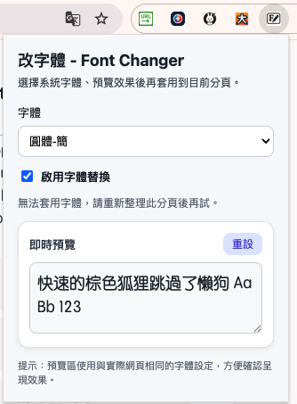

# Website Font Changer 333 Chrome Extension

Website Font Changer 333 是一個用來替換網頁字體的 Chrome/Brave 擴充套件，讓你可以用自己系統裡已安裝的字體閱讀網站內容。

## 功能

- 從系統可用字體中挑選要套用的字體
- 保留最簡單的單一字體模式，適合大多數使用者
- 提供 `單一字體` / `CJK / 英數分開` 內部 tab，可分開指定 `CJK（中日韓）` 與 `非 CJK（英數與標點）`
- 啟用或停用目前分頁的字體替換
- 針對目前網站設定「不生效」，並記錄在該網站的 `localStorage`
- 在 popup 內即時預覽字體效果
- 將設定儲存在 `chrome.storage.sync`
- 支援一般頁面與多數 iframe 內容

## 版本

目前版本：`1.8.4`

本次版本修正：

- **修復「CJK / 英數分開」模式失效與分頁套用報錯問題**：
  - 擴充 `@font-face` 的 `local()` 字體名稱匹配候選（自動涵蓋 PostScript 名稱與完整字體名稱，如 `777jf-Medium`、`777jf金萱 半糖`、`-Regular`、`-Medium` 等），解決 macOS Chrome 在 `local()` 僅傳入字體家族名稱時匹配失敗、導致中文字被帶有中文字形的英數字體（如 `777monolisa Regular 繁中`）整碗端走的問題。
  - 擴充 `CJK_UNICODE_RANGE` 納入全形標點符號區段（`U+FE30-FE4F`、`U+FF00-FFEF`）。
  - 修正 `content.js` 的 `changeFont` 訊息未呼叫 `sendResponse` 導致彈出視窗誤報「無法套用字體，請重新整理此分頁後再試」的問題，並支援重複注入冪等保護與跨網域 iframe（如內嵌 YouTube 播放器）的主框架降級注入。
- **徹底修復 Google 與各式網頁 Icon（圖示）顯示失效問題**：
  - 修正 `MutationObserver` 累積佇列遺失問題（過去快速動態載入如 Google 搜尋、Gmail、YouTube 時會覆蓋 clearTimeout 丟棄高達 90% 的新增節點），全面改為 `pendingMutations` 佇列處理。
  - 補足 Google 網域自動判斷（`isGoogleSite`），支援現代 Google 混淆類別（`z1asCe`、`VfPpkd-*`）、`[jsname]` 與 SVG 元素屬性。
  - 於 CSS `EXCLUDE_CLASSES` 前置排除 Google 官方圖示關鍵屬性（`[class*="notranslate"]`、`[translate="no"]`、`.z1asCe`、`svg`、`svg *`、`g-icon`、`yt-icon` 等），杜絕樣式生效瞬間的文字覆蓋。
  - 支援 Unicode 私用區（PUA, Private Use Area `U+E000`–`U+F8FF`）編碼圖示保護，防止自訂字體無字形導致圖示顯示為破圖方塊 `[?]`。
  - 修復 `INTERACTIVE_EXCLUDE_SELECTOR` 污染整個卡片問題（移除 `[jsaction]`、`[aria-haspopup]` 等全域屬性），並實現圖示按鈕智慧識別，保留文字按鈕（如「搜尋」）的字體替換。
  - 擴充 Google Material Icons / Symbols 單字清單（涵蓋 `history`、`inbox`、`archive`、`undo`、`redo`、`event`、`today` 等）。
- **全新品牌視覺風格（全面對齊 david888.com 與 2md.aiurl.tw）**：
  - 導入五大品牌基底色：金黃藏紅花色（Saffron `#ffb010`）、深海深藍（Deep Blue `#17324d`）、暖白奶油色（Warm Cream `#fff9e8`）、暖調畫布色（Canvas `#fff0cc`）與深墨色（Ink `#2b251a`），搭配陶土色（Clay `#a9471d`）提示重點。
  - 新增深色模式支援（Deep Navy Command Center Dark Mode：`#0c1927` 深藍黑底、`#13273c` 卡片、`#ffb010` 金黃高亮）。
  - 介面標頭加入標誌性的 `333` 金黃徽章，強化產品品牌辨識度。
- **嚴格符合 WCAG 2.1 AA / AAA 無障礙色彩對比標準**：
  - 主要文字色彩對比度超越 AAA 規範（淺色模式 14.6:1、深色模式 14.4:1）。
  - 次要文字與控制項外框色彩對比全面通過 WCAG 1.4.11（>= 3.0:1）非文字元素規範。
  - 金黃藏紅花色背景一律使用深色文字（`#0f2337` / `#2b251a`），堅決杜絕低對比的白字問題。
  - 鍵盤焦點導航支援高辨識度外框環（Focus Ring，淺色 `#17324d`，深色 `#ffb010`，偏移 2px）。
- **網頁版與 Chrome 擴充套件雙重支援**：
  - 新增 `index.html` 獨立網頁版進入點，可直接在一般網頁伺服器或瀏覽器開啟測試。
  - 自適應 Bento 排版：在擴充套件彈出視窗（<= 420px）保持緊湊 360px 視窗；在標準網頁環境（> 420px）自動居中呈現簡約質感的獨立卡片容器。
  - `popup.js` 內建無縫環境感知機制：在擴充套件環境使用 `chrome.storage.sync` 與 `chrome.fontSettings`；在網頁版無縫降級至 `localStorage`、瀏覽器 `queryLocalFonts()` 與繁體中文/系統字體精選清單，徹底避免 API 未定義錯誤。

上一版更新：

- 修正 Google Maps、Telegram Web、104 招募管理等網站的 icon font 被誤套自訂字體，導致圖示變成亂碼或方塊的問題
- 擴充 icon 排除規則，納入 `google-symbols`、`icon`、`iconfont`、`arrow-icon` 與常見 `icon-*` 命名模式
- 補上對 icon 排除規則的 Node 測試，降低後續調整 selector 時再次破壞圖示的風險
- 改用 `chrome.fontSettings.getFontList()` 的 `displayName` 當作 CSS `font-family`
- 保留舊版 `fontId` 設定的相容讀取，避免升級後遺失原設定
- 擴大字體覆蓋範圍到 `html`、表單元素與 frame
- 補上 `CHANGELOG.md`
- 對已開啟但尚未載入 content script 的分頁補做動態注入，減少「要先手動重新整理才有用」的情況
- 對 open shadow DOM 與動態插入內容同步補上字體樣式，提升元件化網站的覆蓋率
- 新增「此網站不生效」開關，使用網站自己的 `localStorage` 記住站點排除設定

## 為什麼之前可能會失效

先前版本直接把 `fontId` 當成 CSS 字體名稱使用。`fontId` 是 Chrome 擴充 API 的識別值，不保證等於網頁 CSS 可直接套用的字體 family name，因此在部分字體或瀏覽器版本下，可能看起來像是「突然改不了字體」。

另外，以下頁面本來就可能無法被擴充套件修改，或只能部分修改：

- `chrome://`、`brave://` 等瀏覽器內建頁面
- Chrome Web Store 或其他受限制頁面
- 使用 closed shadow DOM、canvas、SVG path 或圖片輸出的文字內容

## 安裝

1. 下載或 clone 這個專案。
2. 打開 `chrome://extensions/` 或 `brave://extensions/`。
3. 開啟右上角的「開發者模式」。
4. 點擊「載入未封裝項目」。
5. 選擇這個專案資料夾。
6. 如果已經載入過舊版，請按一次重新整理按鈕，確保 `manifest.json` 的版本更新生效。

## 使用方法

1. 打開你要閱讀的網站頁面。
2. 點擊工具列中的 Website Font Changer 333 圖示。
3. 從下拉選單選擇字體。
4. 開啟「啟用字體替換」。
5. 如果目前分頁沒有立即更新，重新整理一次該分頁再試。

如果你想要把 CJK（中日韓）和英數分開套不同字體：

1. 切到 `CJK / 英數分開` tab。
2. 分別選擇 `CJK（中日韓）` 與 `非 CJK（英數與標點）` 的字體。
3. 開啟「啟用字體替換」。
4. 若要回到原本做法，切回 `單一字體` tab。

## 技術細節

- 使用 Chrome Extension Manifest V3
- 透過 `chrome.fontSettings` 讀取系統字體清單
- 透過 content script 將樣式注入目前頁面
- 使用 `chrome.storage.sync` 保存 `basic` / `advanced` 模式與各自的字體設定，進階設定會保存字體顯示名稱與 `fontId`
- 進階模式透過 `unicode-range` 的 `@font-face` 將 CJK 字體限制在 CJK 範圍，並以直接 `font-family` 方式套用第二套非 CJK 字體
- 使用網站本身的 `localStorage` 保存每個網站是否停用字體替換
- content script 已設定 `all_frames`、`match_about_blank`、`match_origin_as_fallback`

## 檔案結構

- `manifest.json`: 擴充套件設定
- `popup.html`: popup 介面
- `popup.js`: popup 邏輯與字體選擇
- `content.js`: 頁面字體注入邏輯
- `CHANGELOG.md`: 版本異動紀錄
- `images/`: 圖示

## 開發與驗證

每次修改後，建議至少檢查：

- 重新載入 unpacked extension
- 在 Chrome 與 Brave 各測一個一般網站
- 測試一個含有 iframe 的頁面
- 切換 `單一字體` 與 `CJK / 英數分開` 後確認 popup 預覽與實際頁面一致
- 驗證切換 `單一字體` / `CJK / 英數分開` tab 時，只有目前模式的設定會顯示並生效

本次已完成的基本檢查：

- `node --check popup.js`
- `node --check content.js`
- `node --test content.test.js`

## 貢獻

歡迎提出 issue 或 pull request。

## 許可證

本專案採用 MIT License。
