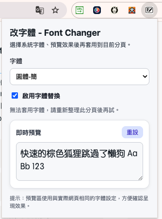

# Website Font Changer 333 Chrome Extension

Website Font Changer 333 是一個用來替換網頁字體的 Chrome/Brave 擴充套件，讓你可以用自己系統裡已安裝的字體閱讀網站內容。

## 功能

- 從系統可用字體中挑選要套用的字體，或選用內建清單的 10 款 **Google Fonts 雲端精選字體**（按需載入，免安裝字體即可跨裝置使用；若目標網站設有嚴格 CSP 限制外部字體則自動退回系統字體）
- 保留最簡單的單一字體模式，適合大多數使用者
- 提供 `單一字體` / `CJK / 英數分開` 內部 tab，可分開指定 `CJK（中日韓）` 與 `非 CJK（英數與標點）`
- 啟用或停用目前分頁的字體替換
- 針對目前網站設定「不生效」，透過 `chrome.storage.sync` 的 `siteDisabled:<host>` 跨裝置同步（無痕分頁僅於當次分頁記憶體暫時生效，絕不同步）；多層跨網域 iframe 採任一方停用即停用之聯集規則
- 在 popup 內即時預覽字體效果（對跨裝置未安裝的同步字體保留唯讀提示）
- 將全域字體與站點排除設定儲存在 `chrome.storage.sync`
- 支援一般頁面、Open Shadow DOM、Document Picture-in-Picture 與多數 iframe 內容

## 版本

目前版本：`2.2.0`

`2.2.0` 更新項目：

- **新增 10 款 Google Fonts 雲端精選字體（按需載入，無須新增擴充套件權限）**：
  - 於「單一字體」與「CJK / 英數分開 → 非 CJK」選單及「網站規則管理頁」新增 `雲端字體 (Google Fonts・按需載入)` 分組，提供 `JetBrains Mono`、`Fira Code`、`Google Sans Code`、`Geist Mono`、`Source Code Pro`、`Intel One Mono`、`Lilex`、`Atkinson Hyperlegible Mono`、`Atkinson Hyperlegible` 與 `Anonymous Pro`。
  - 採用與本機字體隔離的 `gf:*` 識別策略：使用預設或本機系統字體時維持零外部請求；僅在選用雲端字體時才於彈窗預覽與目前頁面按需注入帶有 `referrerpolicy="no-referrer"` 的 Google Fonts 樣式表，並在切換／停用時完整清理；亦不觸發冗餘的圖示重掃。
  - 新增雙語靜態 **What's New 與快速上手指引頁（`extension/whats-new.html`）**：同頁內建繁體中文與英文版、快速導覽與中英顯示切換；版本更新後第一次點開彈窗時會在**背景分頁**開啟更新說明（不搶走目前彈窗焦點），並可隨時透過彈窗底部「更新說明」按鈕重新檢視。
  - 同步更新 `PRIVACY_POLICY.md` 揭露按需連線至 Google Fonts CDN 之行為（少數設定嚴格 `font-src`/`style-src` CSP 的網站可能會退回系統字體）。

`2.1.2` 修正項目：

- **徹底修復動態網頁、AI 串流、捲動與多元件網站上的 Chrome CPU 飆高與 RAM 耗盡問題**：
  - 嚴格收斂 Phase 0 圖示預篩選與 `STYLE_FONT_OR_VAR_REGEX`，使一般中英文段落、`<code>`/`<pre>` 程式碼區塊、60fps `transform`/`opacity` 動畫與 `--scroll-y` / `--tw-*` CSS 變數變動完全不再觸發 `sheet.disabled` 全頁雙重樣式重算，並於頁面初載先掃描再掛載規則樣式表（初載 0 次切換）。
  - 重構 `MutationObserver` 為同步萃取目標元素至有上限（`2,500`）之去重集合，立即釋放 `MutationRecord` 與已移除的 `removedNodes` DOM 子樹供 GC 回收，消除 `setTimeout(0)` 連續阻塞風暴。
  - 同文件下所有 Open `ShadowRoot` 共用單一 `CSSStyleSheet`（如 YouTube 上千個元件從上千份樣式表降為 1 份，開關成本降至 `O(1)`）。
  - 過濾無關的 CJK `unicode-range` WebFont 子集 `loadingdone` 事件避免捲動時反覆全頁重掃、合併 `<link rel="stylesheet">` 載入防抖、為 `ligatureRatioCache` 加入 `512` 筆 LRU 上限淘汰，並於 `background.js` / `shared.js` 加入跨 iframe 本機字重探測快取與空白 `about:blank` 子框架延遲探測。

`2.1.1` 修正項目：

- **修正 Gemini 等大型 SPA 在「CJK / 英數分開」模式下的字體重載無限迴圈與上傳卡住問題**：將擴充套件建立的 `@font-face` 宣告抽離至獨立且常駐啟用的 `CSSStyleSheet`，避免偵測圖示時切換 `sheet.disabled` 反覆卸載／重載自訂字體並連續觸發 `document.fonts` `loadingdone`；同步修正 `loadingdone` 過濾順序、單一元素 `500ms` pending 上限收斂，以及逾時後仍以 Signal 2/3 保護 `Google Symbols` / `Luminous Symbols` 等多 subset 圖示字體。

`2.1.0` 新增功能與效能／版面改善：

- **特定網站專用字體**：可於彈窗切換「全域預設 / 僅此網站」，為個別網站指定專屬的「單一字體」或「CJK / 英數分開」設定，並支援跨裝置同步（無痕分頁僅保留於當次分頁記憶體）。
- **工具列圖示 `OFF` 徽章**：當目前網站已被排除時，Chrome 擴充套件圖示自動顯示 `OFF` 徽章提示。
- **網站規則管理頁面（`options.html`）**：集中瀏覽、搜尋、新增與移除所有「已排除網站」與「特定網站專用字體」規則。
- **意見反應入口**：於彈窗底部與規則管理頁提供「意見反應」連結，引導前往 `https://david888.com/contact`。
- **CPU 效能與彈窗高度修正**：最佳化動態網頁之 `MutationObserver`、`sheet.disabled` 與 `document.fonts` 處理流程，並精簡彈窗版面確保高度完整顯示不截斷。

`2.0.0` 完成重大架構重整與圖示／字重／同步可靠性全面升級：

- **目錄隔離與共用核心**：將執行期檔案集中於 `extension/`（可直接載入開發或壓縮打包上架 Chrome Web Store），並抽出零建置共用模組 `extension/shared.js` 供彈窗與內容腳本共用。
- **無污染圖示保護管線**：改採 `adoptedStyleSheets`（同步切換 `sheet.disabled` 讀取真實計算樣式）搭配三重圖示訊號（PUA 碼位、明確圖示字體關鍵字／純 PUA `FontFace` 集合、ASCII 連字 Canvas `monospace` ZWNJ 寬度塌縮檢測）；獨立鎖定 `::before`/`::after` 偽元素圖示並保留元素原本字體，同時修正 `auto_machine`、`u_uuuu_uuuu` 等一般底線文字誤排除問題與 Google Symbols 連字大小寫問題。
- **完整生命週期與記憶體洩漏防護**：實作 Dormant／Active 狀態機（停用期間零背景觀察器）、單例控制器重注入銷毀、上下文失效自我卸載、`WeakRef` Open Shadow DOM 修剪，以及更安全的 Google Meet Document PiP 字體資源複製與清理。
- **分流模式日韓補齊與免授權字重探測**：補齊日文假名與韓文諺文至 `CJK_UNICODE_RANGE`；由 `shared.js` 於執行期記憶體探測本機粗／斜／粗斜槽位，移除 `chrome.storage.local` 跨站探測快取與個人字體硬編碼。
- **站點排除同步與無痕隔離**：從各站 `localStorage` 單次延遲遷移至 `chrome.storage.sync`（無痕視窗零寫入、改以分頁記憶體覆寫），實作 `ancestorOrigins` 多層跨網域 iframe 聯集停用，並改為唯讀啟動彈窗。

`1.8.7` 修正分流模式中固定字重的本機字體無法顯示粗體的問題，並新增 headless Chrome 實際渲染測試，確認粗體和斜體與正常文字的像素結果不同。

`1.8.6` 修正 CJK / 英數分流：兩套字體都透過 `unicode-range` 限制字元範圍，移除未限制範圍的中文字體 fallback，避免英數缺字時被中文字體接走，也避免合併字體的中文字形覆蓋 CJK 設定。全形英文字母與數字改走英數字體，中文標點保留 CJK 字體；不改寫網頁原文，因此全形字元仍保留全形寬度。

`1.8.4` 版本修正：

- **修復「CJK / 英數分開」模式失效與分頁套用報錯問題**：
  - 擴充 `@font-face` 的 `local()` 字體名稱匹配候選（自動涵蓋 PostScript 名稱與完整字體名稱，如 `777jf-Medium`、`777jf金萱 半糖`、`-Regular`、`-Medium` 等），解決 macOS Chrome 在 `local()` 僅傳入字體家族名稱時匹配失敗、導致中文字被帶有中文字形的英數字體（如 `777monolisa Regular 繁中`）整碗端走的問題。
  - 擴充 `CJK_UNICODE_RANGE` 納入全形標點符號區段（`U+FE30-FE4F`、`U+FF00-FFEF`）。
  - 修正 `content.js` 的 `changeFont` 訊息未呼叫 `sendResponse` 導致彈出視窗誤報「無法套用字體，請重新整理此分頁後再試」的問題，並支援重複注入冪等保護與跨網域 iframe（如內嵌 YouTube 播放器）的主框架降級注入。
- **徹底修復 Google 與各式網頁 Icon（圖示）顯示失效問題**：
  - 修正 `MutationObserver` 累積佇列遺失問題（過去快速動態載入如 Google 搜尋、Gmail、YouTube 時會覆蓋 clearTimeout 丟棄高達 90% 的新增節點），全面改為 `pendingMutations` 佇列處理。
  - 補足 Google 網域自動判斷（`isGoogleSite`），支援現代 Google 混淆類別（`z1asCe`、`VfPpkd-*`）、`[jsname]` 與 SVG 元素屬性。
  - 於 CSS `EXCLUDE_CLASSES` 前置排除 Google 官方圖示關鍵屬性（`[class*="notranslate"]`、`[translate="no"]`、`.z1asCe`、`svg`、`svg *`、`g-icon`、`yt-icon` 等），杜絕樣式生效瞬間的文字覆蓋。
  - 支援 Unicode 私用區（PUA, Private Use Area `U+E000`–`U+F8FF`）編碼圖示保護，防止自訂字體無字形導致圖示顯示為破圖方塊 `[?]`。
  - 修復 `INTERACTIVE_EXCLUDE_SELECTOR` 污染整個卡片問題（移除 `[jsaction]`、`[aria-haspopup]` 等全域屬性），並實現圖示按鈕智慧識別，保留文字按鈕（如「搜尋」）的字體替換。
  - 擴充 Google Material Icons / Symbols 單字清單（涵蓋 `history`、`inbox`、`archive`、`undo`、`redo`、`event`、`today` 等）。
- **全新品牌視覺風格（全面對齊 david888.com 與 2md.aiurl.tw）**：
  - 導入五大品牌基底色：金黃藏紅花色（Saffron `#ffb010`）、深海深藍（Deep Blue `#17324d`）、暖白奶油色（Warm Cream `#fff9e8`）、暖調畫布色（Canvas `#fff0cc`）與深墨色（Ink `#2b251a`），搭配陶土色（Clay `#a9471d`）提示重點。
  - 新增深色模式支援（Deep Navy Command Center Dark Mode：`#0c1927` 深藍黑底、`#13273c` 卡片、`#ffb010` 金黃高亮）。
  - 介面標頭加入標誌性的 `333` 金黃徽章，強化產品品牌辨識度。
- **嚴格符合 WCAG 2.1 AA / AAA 無障礙色彩對比標準**：
  - 主要文字色彩對比度超越 AAA 規範（淺色模式 14.6:1、深色模式 14.4:1）。
  - 次要文字與控制項外框色彩對比全面通過 WCAG 1.4.11（>= 3.0:1）非文字元素規範。
  - 金黃藏紅花色背景一律使用深色文字（`#0f2337` / `#2b251a`），堅決杜絕低對比的白字問題。
  - 鍵盤焦點導航支援高辨識度外框環（Focus Ring，淺色 `#17324d`，深色 `#ffb010`，偏移 2px）。
- **網頁版與 Chrome 擴充套件雙重支援**：
  - 新增 `index.html` 獨立網頁版進入點，可直接在一般網頁伺服器或瀏覽器開啟測試。
  - 自適應 Bento 排版：在擴充套件彈出視窗（<= 420px）保持緊湊 360px 視窗；在標準網頁環境（> 420px）自動居中呈現簡約質感的獨立卡片容器。
  - `popup.js` 內建無縫環境感知機制：在擴充套件環境使用 `chrome.storage.sync` 與 `chrome.fontSettings`；在網頁版無縫降級至 `localStorage`、瀏覽器 `queryLocalFonts()` 與繁體中文/系統字體精選清單，徹底避免 API 未定義錯誤。

上一版更新：

- 修正 Google Maps、Telegram Web、104 招募管理等網站的 icon font 被誤套自訂字體，導致圖示變成亂碼或方塊的問題
- 擴充 icon 排除規則，納入 `google-symbols`、`icon`、`iconfont`、`arrow-icon` 與常見 `icon-*` 命名模式
- 補上對 icon 排除規則的 Node 測試，降低後續調整 selector 時再次破壞圖示的風險
- 改用 `chrome.fontSettings.getFontList()` 的 `displayName` 當作 CSS `font-family`
- 保留舊版 `fontId` 設定的相容讀取，避免升級後遺失原設定
- 擴大字體覆蓋範圍到 `html`、表單元素與 frame
- 補上 `CHANGELOG.md`
- 對已開啟但尚未載入 content script 的分頁補做動態注入，減少「要先手動重新整理才有用」的情況
- 對 open shadow DOM 與動態插入內容同步補上字體樣式，提升元件化網站的覆蓋率
- 新增「此網站不生效」開關，使用網站自己的 `localStorage` 記住站點排除設定

## 為什麼之前可能會失效

先前版本直接把 `fontId` 當成 CSS 字體名稱使用。`fontId` 是 Chrome 擴充 API 的識別值，不保證等於網頁 CSS 可直接套用的字體 family name，因此在部分字體或瀏覽器版本下，可能看起來像是「突然改不了字體」。

另外，以下頁面本來就可能無法被擴充套件修改，或只能部分修改：

- `chrome://`、`brave://` 等瀏覽器內建頁面
- Chrome Web Store 或其他受限制頁面
- 使用 closed shadow DOM、canvas、SVG path 或圖片輸出的文字內容

## 安裝與打包上架

1. 下載或 clone 這個專案。
2. 打開 `chrome://extensions/` 或 `brave://extensions/`。
3. 開啟右上角的「開發者模式」。
4. 點擊「載入未封裝項目」，選擇專案內的 `extension/` 資料夾（`2.0.0` 起所有執行期檔案已集中於此目錄）。
5. 如果已經載入過舊版，請按一次重新整理按鈕，確保 `extension/manifest.json` 的版本更新生效。
6. 若要打包上傳 Chrome Web Store，直接將 `extension/` 資料夾內容壓縮為 `.zip` 即可（不含測試程式或開發文件）。

## 使用方法

1. 打開你要閱讀的網站頁面。
2. 點擊工具列中的 Website Font Changer 333 圖示。
3. 從下拉選單選擇字體。
4. 開啟「啟用字體替換」。
5. 如果目前分頁沒有立即更新，重新整理一次該分頁再試。

如果你想要把 CJK（中日韓）和英數分開套不同字體：

1. 切到 `CJK / 英數分開` tab。
2. 分別選擇 `CJK（中日韓）` 與 `非 CJK（英數與標點）` 的字體。
3. 開啟「啟用字體替換」。
4. 若要回到原本做法，切回 `單一字體` tab。

## 技術細節

- 使用 Chrome Extension Manifest V3（零額外權限，維持 `activeTab`、`storage`、`fontSettings`、`scripting`）
- 透過 `chrome.fontSettings` 讀取系統字體清單
- 透過 `adoptedStyleSheets`（`CSSStyleSheet`）與 content script 將樣式注入目前頁面，並保護各類網頁圖示與偽元素字體
- 使用 `chrome.storage.sync` 保存 `basic` / `advanced` 模式、各自字體設定與 `siteDisabled:<host>` 站點排除紀錄
- 進階模式透過兩組 `unicode-range` 的 `@font-face` 分別限制 CJK（含中文、日文假名、韓文諺文）與非 CJK 字體，並透過執行期記憶體 `FontFace.load()` 探測本機粗／斜／粗斜字重
- content script 已設定 `all_frames`、`match_about_blank`、`match_origin_as_fallback`，並結合 `location.ancestorOrigins` 實現跨網域 iframe 聯集停用

## 檔案結構

- `extension/`：Chrome Web Store 發行／載入用純執行期目錄
  - `manifest.json`：擴充套件設定
  - `shared.js`：彈窗與內容腳本共用之純函式與常量核心
  - `popup.html`：彈窗介面
  - `popup.js`：唯讀彈窗邏輯與字體選擇
  - `content.js`：生命週期控制器、圖示保護、PiP 與字體注入邏輯
  - `images/`：擴充套件圖示
- `tests/`：自動化單元測試與跨平台雙埠真實 Chrome 整合測試
- `assets/`：非執行期圖示素材
- `CHANGELOG.md`：版本異動紀錄

## 開發與驗證

每次修改後，建議至少檢查：

- 重新載入 `extension/` 未封裝擴充套件
- 在 Chrome 與 Brave 實測 Google（Fonts / Meet 含 Document PiP / Play）、Outlook、YouTube、GitHub（含 `auto_machine`）、Disp BBS（含 `u_uuuu_uuuu`）、含跨網域 iframe 頁面與無痕分頁

自動化檢查與測試指令：

- `node --check extension/shared.js extension/content.js extension/popup.js`
- `node --test tests/shared.test.js tests/content.test.js tests/popup.test.js tests/font-rendering.test.js`（真實 Chrome 測試可使用 `FONT_CHANGER_CHROME` 指定執行檔路徑）

## 貢獻

歡迎提出 issue 或 pull request。

## 許可證

本專案採用 MIT License。
